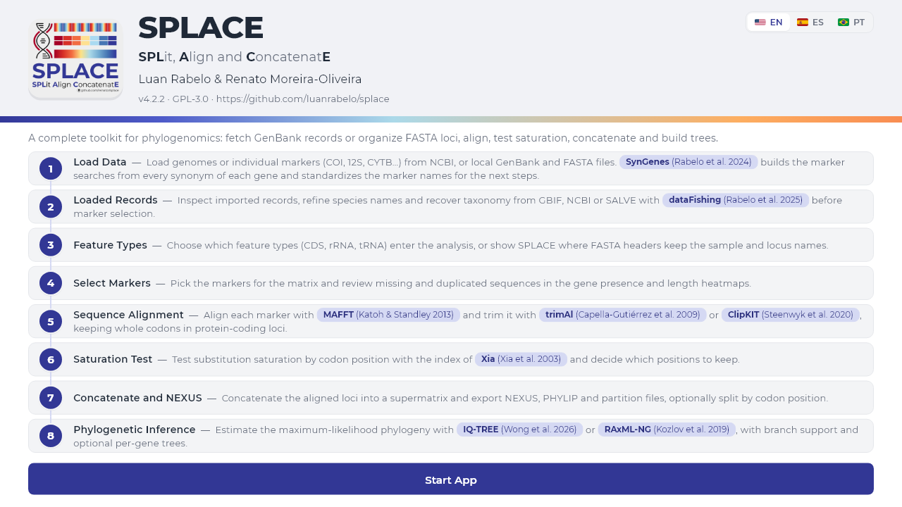

# SPLACE GUI (desktop app)

Flutter desktop application of SPLACE for Windows, Linux and macOS: the
whole workflow from GenBank or FASTA input to edited tree figures, with the
analysis tools bundled.

**The user guide, with a screenshot of every screen, is in the
[main README](../README.md#splace-gui).** This file is for building, testing
and packaging the app.



## Workflow

| Step | Screen | What it does |
| --- | --- | --- |
| 1 | Load Data | NCBI search by taxon (genomes or individual markers built from SynGenes names), accession numbers, local GenBank files or local FASTA files (Sample and marker organizer) |
| 2 | Loaded Records | species identification (BLAST + BOLD), taxonomy from GBIF, NCBI or ICMBio SALVE (dataFishing), records table |
| 3 | Feature Types / Sample and Locus Fields | CDS, rRNA, tRNA with SynGenes standardization; for FASTA, where sample and locus names come from |
| 4 | Select Markers | marker choice, missing and duplicated genes, gene presence and length heatmaps |
| 5 | Sequence Alignment | header builder, nucleotide / amino acid / codon-aware, MAFFT, trimAl or ClipKIT (keeping whole codons), alignment viewer |
| 6 | Saturation Test | PhyKIT saturation per marker and codon position, plots and a pooled recommendation |
| 7 | Concatenate and NEXUS | supermatrix, partitions (by locus and/or codon position), position exclusion, outgroups, NEXUS / PHYLIP / FASTA |
| 8 | Phylogenetic Inference | IQ-TREE3 and RAxML-NG (alone or both), per-gene trees, run history |
| 9 | Tree Viewer | full-window tree editor, tree comparison, SVG/PNG/Newick export, results ZIP, methods text and references |

Screenshots of every step are in [`screenshots/`](screenshots/).

## Layout

```
lib/src/core/       pure Dart, unit-tested, isolate-safe
  fasta.dart            FASTA I/O, taxon-name sanitizing
  genbank.dart          GenBank parser, locations (join/complement/order), taxonomy
  syngenes.dart         SynGenes standardization (+ generated syngenes_data.dart)
  marker_search.dart    NCBI queries for individual markers from SynGenes names
  genbank_markers.dart  gene catalog, duplicates, FASTA headers, CDS extraction
  genetic_code.dart     NCBI codes, CDS validation, translation, back-translation
  locus_organizer.dart  header fields, layout detection, locus × sample matrix
  saturation.dart       saturation verdicts and the pooled recommendation
  phykit.dart           PhyKIT saturation runs and output parsing
  supermatrix.dart      concatenation, codon-position exclusion, partition files
  alignment_tools.dart  codon-preserving trimming, alignment statistics
  tool_commands.dart    MAFFT/trimAl/IQ-TREE/RAxML-NG arguments, log & scheme parsers
  newick.dart, tree_compare.dart, outgroup.dart   trees, comparison, rooting
lib/src/services/   tool discovery (tools/ → PATH → WSL), async process runner,
                    NCBI E-utilities, GBIF, species identification, resource monitor
lib/src/state/      ProjectController: the analysis flow, work folders, logs
lib/src/ui/         interface (same look as the HTML app in ../docs)
  shell.dart            top bar, step navigator, single scrolling page, log, status bar
  chrome/               welcome screen, tools, API key, progress and review dialogs
  sections/             the steps (load, records, fields, markers, alignment,
                        saturation, concatenation, inference, tree viewer)
lib/l10n/           strings in en/pt/es (generated by tool/gen_arb.py)
tool/package/       packaging scripts (see below)
tool/raxml-ng-windows/  native Windows build of RAxML-NG
screenshots/        PNG of every screen, used by the documentation
```

The window is at least 1280×720. Heavy work (parsing, concatenation,
statistics) runs in isolates, and every external tool runs with
`Process.start`, streaming its log and cancellable, so the interface never
freezes, even with hundreds of markers.

Each project writes to `Documents/SPLACE/projects/<timestamp>/` (changeable
in Settings): `01_loci`, `02_aligned`, `03_trimmed`, `04_saturation`,
`05_matrix`, `06_trees/<engine>_<timestamp>`. Preferences (theme, language,
NCBI API key, tool paths) are kept in `Documents/SPLACE/settings.json`.

## Running

```bash
cd GUI
flutter run -d windows        # or linux / macos
flutter build windows --release
```

`flutter build windows` / `flutter build linux` copy the external tools from
`../electron/bin/<platform>` (CMake cache variable `SPLACE_TOOLS_DIR`) into a
`tools/` folder next to the executable, so the release folder is
self-contained. On macOS the Xcode build phase `macos/bundle_tools.sh` copies
`../electron/bin/mac` into `SPLACE.app/Contents/Resources/tools`.

| Platform | Bundled tools |
| --- | --- |
| Windows | MAFFT (`mafft.bat` + MSYS2 `usr/`), trimAl, IQ-TREE3, RAxML-NG (`raxml-ng.exe`, built from the official source by `tool/raxml-ng-windows`) |
| Linux | trimAl, IQ-TREE3, RAxML-NG; MAFFT comes from the distribution (.deb) or is built into the AppImage |
| macOS | MAFFT, trimAl, IQ-TREE3, RAxML-NG (universal: Apple silicon and Intel) |

ClipKIT and PhyKIT are added to the Windows and Linux packages as
standalone programs (PyInstaller); without them the app uses
`python -m clipkit` / `phykit`.

Tools are looked up in this order: custom path from the tools dialog (a
native path or `wsl:/path/inside/wsl`), the app's `tools/` folder, the
repository's `electron/bin/<platform>` (development), `PATH`, and on
Windows, WSL as a last resort.

## Packages

Each script builds a release and packs it with the bundled tools into
`dist/`:

| Package | Command (from `GUI/`) | Needs |
| --- | --- | --- |
| Windows portable `.exe` | `powershell -ExecutionPolicy Bypass -File tool\package\windows.ps1` | Windows, Flutter, Visual Studio C++ build tools, Python 3 |
| Linux `.deb` | `bash tool/package/linux.sh` | Linux, Flutter, `clang cmake ninja-build pkg-config libgtk-3-dev dpkg-dev python3-venv` |
| Linux `.AppImage` | `bash tool/package/appimage.sh` | the same, plus `gcc make curl` (MAFFT is compiled from source) |
| macOS `.dmg` (universal) | `bash tool/package/macos.sh` | a Mac with Xcode and Flutter |

- **Windows**: one portable program, no installation. The first run unpacks
  it to `%LOCALAPPDATA%\SPLACE\portable\<version>`; later runs start at once.
  `-Installer` also builds an Inno Setup installer (needs Inno Setup 6).
- **Linux .deb**: installs to `/opt/splace` and pulls MAFFT from the
  distribution (`sudo apt install ./dist/splace_*.deb`).
- **Linux AppImage**: one file that runs on any recent distribution
  (`chmod +x`, then run it).
- **macOS .dmg**: signed ad hoc only; on another Mac open the app the first
  time with right-click > Open.

`SKIP_BUILD=1` (or `-SkipBuild` on Windows) packs the last release build
again; `NO_PYTHON_TOOLS=1` (`-NoPythonTools`) leaves ClipKIT and PhyKIT out.

The workflow [`.github/workflows/build-gui.yml`](../.github/workflows/build-gui.yml)
builds the four packages on GitHub: run it from the Actions tab, or push a
version tag (`git tag v4.2.2 && git push origin v4.2.2`) to attach them to
the release of that tag.

## Tests

```bash
flutter test                         # unit + widget tests
flutter test test/integration        # real MAFFT/trimAl/IQ-TREE (+ RAxML-NG if found)
SPLACE_NETWORK=1 flutter test        # + live NCBI/GBIF and the GenBank codon-aware pipeline
SPLACE_RAXML_NG=wsl:/path/to/raxml-ng flutter test test/integration
SPLACE_DATASET=/path/to/datasets/inputs flutter test test/core/dataset_test.dart
```

The screenshots in `screenshots/` come from the real interface (bundled
fonts, real pipeline, live NCBI data):

```bash
SPLACE_SCREENSHOTS=build/shots SPLACE_NETWORK=1 flutter test test/screenshots_test.dart          # GenBank flow
SPLACE_SCREENSHOTS=build/shots SPLACE_DATASET=/path/to/inputs flutter test test/screenshots_test.dart  # FASTA flow
```

## About the saturation test

Each marker is tested with PhyKIT `saturation` (Steenwyk et al. 2021;
Philippe et al. 2011): IQ-TREE infers the tree of the gene, its branch
lengths are re-estimated for each codon subset (1st, 2nd, 3rd, 1st+2nd, all
sites) on that topology (`-te`), and PhyKIT regresses the uncorrected
p-distance of every pair of taxa on their patristic distance. A slope near 1
means no saturation; the thresholds for *moderate* and *saturated* are
editable in step 6a. Codon positions are only meaningful for in-frame coding
alignments: the frame is taken from the CDS start or from the frame with the
fewest internal stop codons, and can be changed per locus.
