<p align="center">
  
</p>

<p align="center">
    <h1 align="center">SPLACE (<b>SP</b>Lit, <b>A</b>lign and <b>C</b>oncatenat<b>E</b>)</h1>
</p>

## Platform Compatibility


<table width="100%">
  <thead>
    <tr>
      <th align="center" width="30%">Operating System</th>
      <th align="center" width="30%">Automated Tests</th>
      <th align="center" width="40%">Downloads</th>
    </tr>
  </thead>
  <tbody>
    <tr>
      <td align="left">
        
      </td>
      <td align="left">
        <a href="https://github.com/itvgenomics/splace/actions/workflows/test-ubuntu.yml"></a>
      </td>
      <td align="left">
        <a href="https://github.com/itvgenomics/splace/releases/latest"></a>
      </td>
    </tr>
    <tr>
      <td align="left">
        
      </td>
      <td align="left">
        <a href="https://github.com/itvgenomics/splace/actions/workflows/test-macos.yml"></a>
      </td>
      <td align="left">
        <a href="https://github.com/itvgenomics/splace/releases/latest"></a>
      </td>
    </tr>
    <tr>
      <td align="left">
        
      </td>
      <td align="left">
        <a href="https://github.com/itvgenomics/splace/actions/workflows/test-windows.yml">
          
        </a>
      </td>
      <td align="left">
        <a href="https://github.com/itvgenomics/splace/releases/latest"></a>
      </td>
    </tr>
  </tbody>
</table>

# Contents Overview
- [System Overview](#system-overview)
- [Licence](#licence)
- [SPLACE GUI](#splace-gui)
  - [Download and installation](#download-and-installation)
  - [Welcome screen and interface](#welcome-screen)
  - [Step 1: Load Data](#step-1-load-data)
  - [Step 2: Loaded Records](#step-2-loaded-records)
  - [Step 3: Features and Markers](#step-3-features-and-markers)
  - [Step 4: Sequence Alignment](#step-4-sequence-alignment)
  - [Step 5: Saturation Test](#step-5-saturation-test)
  - [Step 6: Concatenate and NEXUS](#step-6-concatenate-and-nexus)
  - [Step 7: Phylogenetic Inference](#step-7-phylogenetic-inference)
  - [Step 8: Tree Viewer](#step-8-tree-viewer)
  - [Bundled tools and versions](#bundled-tools-and-versions)
- [SPLACE Terminal Mode](#splace-terminal-mode)
  - [Prerequisites](#prerequisites)
  - [Installation](#installation)
  - [Usage](#usage)
    - [Parameter Overview](#parameter-overview)
  - [Example Command](#example-command)
  - [Tool Configuration](#tool-configuration)
  - [Remote Genome Retrieval](#remote-genome-retrieval)
  - [Taxonomy and FASTA Header Metadata](#taxonomy-and-fasta-header-metadata)
  - [Gene Presence Report](#gene-presence-report)
  - [Sequence Identifiers](#sequence-identifiers)
- [SPLACE Workflow](#splace-workflow)
- [Citing SPLACE and the tools](#citing-splace)
- [Contact](#contact)

***
## ⚠️ Windows Security and Digital Signature

### Running SPLACE on managed or corporate Windows computers

The Windows version of **SPLACE Desktop** is currently distributed without a commercial code-signing certificate.

Because of this, Windows may display a security warning when the application is launched. On personal computers, Windows usually allows the user to manually authorize the application. However, on computers managed by companies, universities, research institutions, or other organizations, security policies may completely prevent unsigned applications from running.

This behavior may be caused by Windows security mechanisms or organizational policies such as **Microsoft Defender SmartScreen**, **AppLocker**, or **Windows Defender Application Control (WDAC)**.

In these environments, SPLACE may:

* Be blocked before execution.
* Display a message indicating that the application is from an unknown publisher.
* Be prevented from running even when the user has administrator privileges.
* Require authorization from the organization's IT department.

> [!IMPORTANT]
> This does not necessarily indicate a problem with the SPLACE installation or executable. It may simply mean that the computer's security policy does not allow applications without a trusted digital signature.

### Recommended alternative: Windows Subsystem for Linux (WSL)

If the Windows executable is blocked by your organization's security policy, we recommend running **SPLACE through Windows Subsystem for Linux (WSL)**.

WSL provides a Linux environment directly within Windows and can be used to run the Linux version of SPLACE without relying on the unsigned Windows executable.

For Windows 11 systems with **WSLg** enabled, graphical Linux applications can also be displayed directly on the Windows desktop.

Before using this alternative, verify that WSL is available and permitted by your organization's IT policies.

### For corporate or institutional environments

If installation of unsigned software is restricted, you may also contact your IT department and request authorization to run SPLACE.

Future Windows releases may be digitally signed to improve compatibility with Windows security policies and managed corporate environments.

***
&nbsp;

## System Overview
##### [:rocket: Go to Contents Overview](#contents-overview)
**SPLACE** automates phylogenomic analyses of organellar (mitochondrial and chloroplast) genes and of your own loci: it splits the genes out of GenBank or FASTA files, aligns, trims and concatenates them, and infers the tree. It comes in two forms:

- **SPLACE GUI** (desktop app for Windows, Linux and macOS): the whole workflow, from the NCBI search to the edited tree figure, species delimitation and a methods text for the paper, with every tool bundled.
- **SPLACE Terminal Mode** (Python package and `splace.py`): extraction, alignment, trimming, supermatrix and IQ-TREE 3 inference for pipelines and HPC clusters.

Both rely on published tools: **[SynGenes](https://github.com/luanrabelo/SynGenes)** for gene name standardization, **[dataFishing](https://github.com/luanrabelo/dataFishing)** for taxonomy, **MAFFT** for alignment, **trimAl** (and, in the GUI, **ClipKIT**) for trimming, **IQ-TREE 3** for phylogeny reconstruction and, in the GUI, **PhyKIT** for the saturation test, **RAxML-NG** for a second ML tree and **mPTP**, **GMYC** (with **LSD2**), **ASAP** and **ABGD** for species delimitation.

**Key Features:**
*   **Automatic Extraction:** Detects and extracts CDS, rRNA and tRNA from GenBank files, or loci from FASTA headers, matched to standard names by SynGenes.
*   **Gene Normalization:** Ensures consistent gene naming across datasets (SynGenes).
*   **Alignment & Trimming:** MAFFT alignment (nucleotide, amino acid or codon-aware) and trimAl/ClipKIT trimming that can keep whole codons.
*   **Phylogeny:** Supermatrix with partitions (NEXUS, PHYLIP, FASTA) and ML trees with IQ-TREE 3 and RAxML-NG.
*   **Species delimitation (GUI):** PTP, mPTP and GMYC on the ML trees, ASAP and ABGD on the alignments, shown as bars beside the tips.
*   **Corrected GenBank and BOLD submission (GUI):** GenBank files written back with the identified name, the taxonomy and the standardized gene names; DNA barcodes identified against GenBank and BOLD and exported in BOLD's submission spreadsheet.
*   **Benchmarking:** Metrics for pipeline performance analysis (terminal mode).

### Version Comparison

| Feature | SPLACE v2/v3 (Legacy) | SPLACE (New) |
| :--- | :--- | :--- |
| **Input Method** | Text file list | Automatic Directory Scan |
| **Execution** | Sequential | Asynchronous & Parallel |
| **Gene Normalization** | basic string split | **SynGenes** Integration |
| **Phylogeny** | Concatenation Only | **IQ-TREE 3** (terminal); IQ-TREE 3 + RAxML-NG (GUI) |
| **Species delimitation** | — | **mPTP** (PTP, mPTP), **GMYC**, **ASAP** and **ABGD** (GUI) |
| **Benchmarking** | Manual / Not Built-in | Native (`--benchmark`) |
| **Language/Deps** | Python <3.10 | Python 3.12+ (Asyncio) |

&nbsp;
> [!NOTE]
> This project is an enhanced version of the original SPLACE repository.
> See the original repository at [https://github.com/reinator/splace/](https://github.com/reinator/splace/)

&nbsp;
## Licence
##### [:rocket: Go to Contents Overview](#contents-overview)
**SPLACE** is released under the **GPL-3.0 License**.
&nbsp;

## SPLACE GUI
##### [:rocket: Go to Contents Overview](#contents-overview)

> [!TIP]
> **Case study:** SPLACE step by step on a real dataset (Bufonidae mitogenomes), with annotated animations of every step (what to fill in, numbered and pointed by arrows): [docs/case-study.html](https://itvgenomics.github.io/splace/case-study.html) (source in [`docs/case-study.html`](docs/case-study.html)). The app opens the same tutorial after **Start App**.

The **SPLACE GUI** is the desktop application of SPLACE (source in [`GUI/`](GUI/)). It runs the whole phylogenomic workflow without the command line: it imports organellar genomes, individual markers or your own FASTA files, standardizes gene names, aligns, trims, tests saturation, builds the supermatrix, infers trees with IQ-TREE 3 and RAxML-NG, delimits species with mPTP, GMYC, ASAP and ABGD and lets you edit the final figure.

The analysis tools are **bundled** with the application (MAFFT, trimAl, IQ-TREE 3, RAxML-NG, ClipKIT, PhyKIT, mPTP, LSD2, GMYC, ASAP and ABGD; see [Bundled tools and versions](#bundled-tools-and-versions)), so nothing else needs to be installed. The interface is available in English, Portuguese and Spanish.

> [!NOTE]
> **SPLACE Web** (the browser version in `docs/`) still offers the import, marker selection and FASTA export steps in the browser. The full workflow (alignment to trees) is in the desktop GUI described below.

### Download and installation

Get the package for your system from the [Releases page](https://github.com/itvgenomics/splace/releases/latest):

| System | File | How to run |
| :--- | :--- | :--- |
| Windows 10/11 (x64) | `SPLACE-<version>-windows-x64.exe` | Portable program, no installation: double-click it. The first start unpacks SPLACE once to `%LOCALAPPDATA%\SPLACE`, later starts are immediate. |
| Linux (Debian, Ubuntu…) | `splace_<version>_amd64.deb` | `sudo apt install ./splace_<version>_amd64.deb`, then open **SPLACE** from the applications menu or run `splace`. |
| Linux (any distribution) | `SPLACE-<version>-x86_64.AppImage` | `chmod +x SPLACE-*.AppImage` and run it. Nothing is installed. |
| macOS 12+ (Apple silicon and Intel) | `SPLACE-<version>-macos-universal.dmg` | Open the disk image and drag **SPLACE** to *Applications*. The first time, right-click the app and choose **Open** (the app is not notarized). |

Results are written to `Documents/SPLACE/projects/<date-time>/` (`01_loci`, `02_aligned`, `03_trimmed`, `04_saturation`, `05_matrix`, `06_trees`; each tree run has its own folder, with a `delimitation/` subfolder when species were delimited on it). Preferences (language, theme, NCBI API key, tool paths) are kept in `Documents/SPLACE/settings.json`.

<details open>
<summary>Welcome screen and interface overview</summary>

### Welcome screen

The welcome screen summarizes the eight steps of the workflow and the published tools used in each one. Choose the language (EN, ES, PT) in the top-right corner and click **Start App**. A tutorial then opens: one page per step, with what it is for, what to do there and a tip; each item says what a function does and when to use it (with the app's own icons in the text) and plays a screen of the real app with the place to fill in highlighted and an arrow from the item to it; a progress bar shows the item and the next step; move with the arrows, the step buttons or ← →, and close it at any time (it can also be turned off, and opened again with the **Tutorial** button of the welcome screen). The **?** button of the top bar brings this screen back at any time.


### Interface overview

- **Top bar**: menu button (shows or hides the step navigator), language selector, **NCBI API key** (key icon), **external tools** (wrench), **display settings** (sliders), **activity log**, help, **Open project** (folder, Ctrl+O), **Save project** (disk, Ctrl+S; Ctrl+Shift+S saves as another file), **New project** (+: starts a new analysis in a new folder without closing the app; the previous project stays in its folder) and the GitHub repository.
- **Step navigator** (left): the steps of the workflow with the global progress bar. Each step lists its parts (`1a`, `1b`…); completed steps and parts get a check mark, and steps that still need data from previous steps are locked. Clicking a step or part scrolls the page to it.
- **Workspace** (centre): one scrolling page with a card for each step, revealed as the analysis advances.
- **Status bar** (bottom): version, licence and authors, plus live CPU, RAM, disk and network use.

### Project files (.splc)

**Save project** writes the whole analysis to one `.splc` file (a ZIP): the
records with your edits (names, taxonomy), the FASTA files and how they were
split, the species identifications, the alignments and trimmed alignments,
the saturation results, the supermatrix, the tree and delimitation runs, the
tree figures as you left them in the editor (style, labels, colours, rooting,
collapsed clades…), the log, and the project folder with every file the
tools wrote. **Open project** (top bar or welcome screen, or a double-click
on the file: on Windows SPLACE registers `.splc` for your user when it
starts; the Linux packages register it too) unpacks it into a new
project folder and puts every step back as it was saved, so nothing has to
be run again: change a parameter and only what depends on it runs again.
The title bar of the window shows the project file (full path) and whether
it is saved or has unsaved changes (●).

Send the `.splc` file to a colleague to share the data and the analysis: the
`project.json` inside it lists every parameter of every step (the IQ-TREE
and RAxML-NG command lines included) and can be read with any text editor,
so the work can be checked and reproduced.

### External tools

The wrench button lists every tool SPLACE found (bundled with the app, in `PATH` or, on Windows, inside WSL), with its version and path. A custom path can be set for each tool.


### Display settings and activity log

The sliders button changes the theme (light, dark or automatic), the density and the text size. The activity log (list button) records every search, download, tool call and error with its time; it can be copied, saved as a text file or cleared.


</details>

<details>
<summary>Step 1 - Load Data</summary>

### Step 1: Load Data

Data can come from four sources, and sources can be combined in the same project:

- **1a Search by taxonomic name**: searches NCBI for **genomes** (mitochondrion, chloroplast…) of a taxon, with the options *Complete only* and *RefSeq only*. The query sent to NCBI is shown in *Query preview*. A species name (two words, e.g. *Rhinella marina*) is recognized and shown in italics; switch on **Also search its synonyms (GBIF)** and SPLACE looks the name up in the [GBIF backbone](https://www.gbif.org/species/search), takes the accepted name and its synonyms (species rank or below) and searches all of them in one query (`("Rhinella marina"[Organism] OR "Bufo marinus"[Organism] OR …)`), so records filed under an older name are found too.
- **1b Paste accession numbers**: downloads the GenBank records of a list of accessions.
- **1c Use local GenBank files**: opens `.gb`/`.gbk` files or whole folders.
- **1d Use local FASTA files**: opens your own FASTA files (for example, target-capture loci). SPLACE then opens the **Sample and marker** dialog, where you click the parts of the header that name the sample and the marker (or use the file name, `[gene=…]` tags or a regular expression). It recognizes the common layouts (one file per sample with one sequence per locus, one file per locus, or both names in the header), standardizes sample names and writes one FASTA file per marker with identical sample names, ready to align and concatenate.

**Example data.** Each option of step 1 has its own **Example** button: **1b** fills in example accessions, **1c** loads the GenBank files bundled in [`GUI/assets/examples/genbank`](GUI/assets/examples/genbank), and **1d** has two, **Loci example** ([`loci`](GUI/assets/examples/loci)) and **Barcoding example** ([`barcoding`](GUI/assets/examples/barcoding), loaded with *These sequences are DNA barcodes* on). The files are copied to `Documents/SPLACE/examples/`; a button is disabled while its folder is empty, and files added to these folders are bundled the next time the app is built. What each button's tooltip says is edited in [`GUI/assets/examples/tooltips.json`](GUI/assets/examples/tooltips.json), one text per language, in HTML (`<b>`, `<i>`, `<u>`, `<br>`).

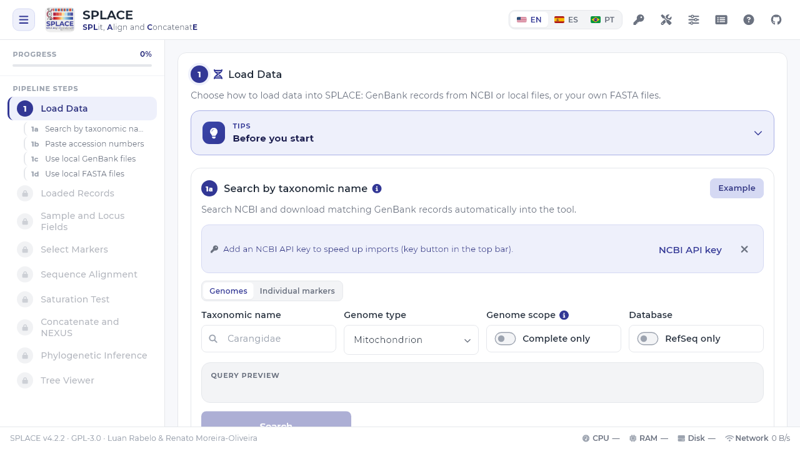

**Individual markers.** When there are no genomes for a group, switch from *Genomes* to *Individual markers* and choose the markers (12S, 16S, COI, CYTB, ND1…). Each marker is searched with every synonym of the gene in [SynGenes](https://github.com/luanrabelo/SynGenes), and the records are joined by species: one sample per species, with missing markers filled as missing data. **BOLD Systems**: for COI and the plant barcodes of the chloroplast (rbcL, matK, rpoB, rpoC1, ycf1), *Also search BOLD Systems* adds the public records of [BOLD](https://portal.boldsystems.org) (v5 portal API) for the same taxon, at any rank (species, genus, family…), and for the synonyms BOLD knows. The review list shows where each record came from: **NCBI**, **BOLD** (with the country and the BIN) or **NCBI + BOLD** when BOLD mirrors a GenBank record, which is then imported once, from GenBank. Records BOLD files under a synonym of the species searched take the accepted name. BOLD-only records are written as GenBank files (`00_ncbi/bold/`) with the voucher, the locality when BOLD has it (`/geo_loc_name` "Colombia: Meta, San Juan de Arama", `/lat_lon`, the site and elevation in a note), the BIN and a partial CDS in the reading frame found under the genetic code of the lineage, and BOLD is cited in the methods text.

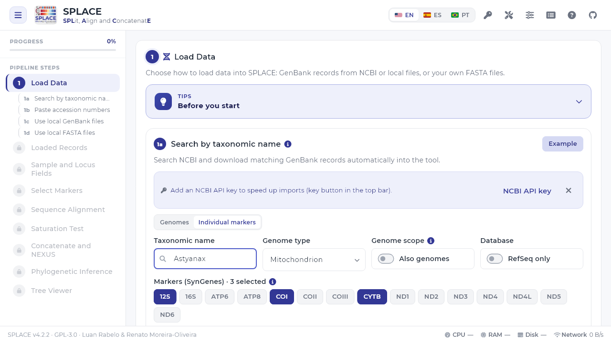

**Review genomes before importing.** Before downloading, SPLACE lists what NCBI found, split into *complete*, *partial* and *UNVERIFIED* records. Filter the list, turn records on or off (or use *Disable UNVERIFIED*, *Only complete*…) and click **Import**.


Downloads show their progress in a window that can be cancelled; downloaded records are cached on disk for seven days.


**NCBI API key.** Without a key NCBI allows 3 requests per second; with a free key, 10. The key window estimates the time saved for 50, 200 and 1,000 genomes and explains how to create a key in your NCBI account. The key is stored only on your computer.

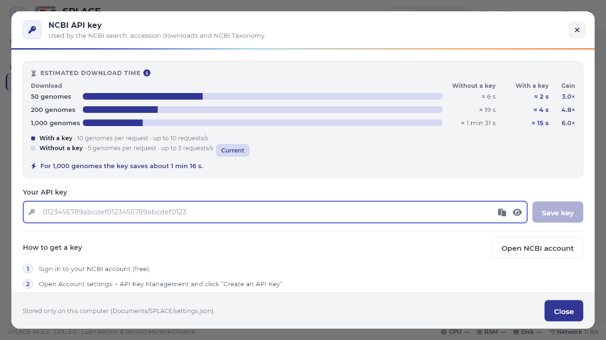

</details>

<details>
<summary>Step 2 - Loaded Records</summary>

### Step 2: Loaded Records

- **2a Species identification** (optional): compares a barcode gene (COI, 16S…) of each genome with GenBank (BLAST) and BOLD to find misidentified records, and lets you choose the name to keep for each genome. **Search parameters**: for GenBank, the BLAST database (`core_nt`, `nt`, RefSeq RNA), the program (`megablast` or the more sensitive `blastn`), e-value, word size, number of results, an Entrez query to restrict the search (e.g. `Bufonidae[Organism]`) and the minimum coverage; for BOLD, the ID engine database (`public.tax-derep`, `species`, `all.tax-derep`, `all.animal-alt` for COI; `public.plants` for rbcL and matK; `public.fungi` for ITS), minimum identity, minimum overlap and number of hits. They are saved with the settings; answers are cached per parameter set. **Alignments**: each candidate (and each barcode) has a button that shows the query and every hit aligned to it, in blocks of 60 columns with the differences and gaps marked, and the identity, coverage, mismatches, gaps, e-value and bit score; BOLD returns only where a hit aligns, so its sequence is fetched from the BOLD portal and aligned in the app. Synonyms are taken into account: the record's name and the best matches are looked up in the GBIF backbone, and hits filed under a synonym (e.g. *Bufo marinus* or *Chaunus marinus* in BOLD) count for the accepted species (*Rhinella marina*), shown as "also as …"; a record named with a synonym is confirmed by its accepted name, which can be chosen to update it.
- **2b Taxonomy of the records**: fetches the classification with the [dataFishing](https://github.com/luanrabelo/dataFishing) method from **GBIF**, **NCBI Taxonomy** or **ICMBio SALVE** (Brazilian fauna, with the extinction-risk category). *Skip taxonomy and proceed* continues without it.


- **Export corrected GenBank** (in 2a after the identification and in 2b after the taxonomy): writes every record again as a `.gb` file with the species name as identified or edited, the lineage of the taxonomy and the gene names standardized by SynGenes (the original name of a renamed gene is kept in a `/note`, and a COMMENT says what was corrected). The original header (references, comments) is kept. This is meant for a newly assembled genome: identify it, fix the name and save the corrected file for submission. A copy also goes to `00_genbank_corrected/` in the project.

- **2c Records table**: every record with its taxonomy, authorship and the number of protein-coding genes (PCGs), rRNAs and tRNAs. Columns can be shown or hidden, the table can be searched, and each record can be edited or removed. Gene counts that differ from the rest of the dataset are highlighted (possible gene loss or duplication).

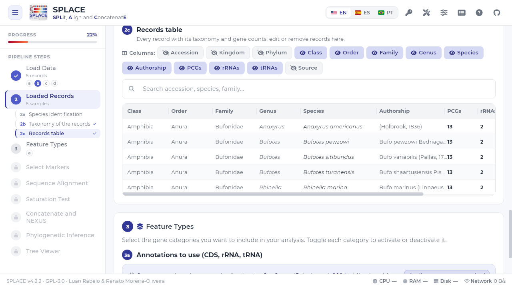

**DNA barcodes (FASTA).** With FASTA input, switch on *These sequences are DNA barcodes* (one specimen per sequence). Choose the barcode marker and click **Identify specimens**: each sequence is compared with GenBank (BLAST) and, for COI, with the BOLD ID Engine; the best match at a same-species identity (98 %) becomes the name of the specimen, and every name can be changed or picked from the matches. **Taxonomy (GBIF)** fills phylum to family of the names kept, and **Export BOLD spreadsheet (.xlsx)** writes BOLD's official BOLD5 single-page specimen template (sheet *Submissions*, the same 50 columns) with the sample id, taxonomy and identification filled, the voucher and collection columns left to you, plus a FASTA of the sequences with the sample ids as headers for the sequence upload.

</details>

<details>
<summary>Step 3 - Features and Markers</summary>

### Step 3: Features and Markers

One step for what enters the matrix: the annotations, then the markers. The parts are lettered in order.

- **3a Feature types**: choose which annotations enter the analysis, **PCGs** (CDS), **rRNAs** and **tRNAs**. Gene names are standardized with SynGenes; names that SynGenes does not recognize are listed so they can be fixed. With FASTA input this part is **Sample and Locus Fields** and shows how the sample and locus names were read from the headers (with both inputs it comes next, as 3b, and the parts below move one letter).

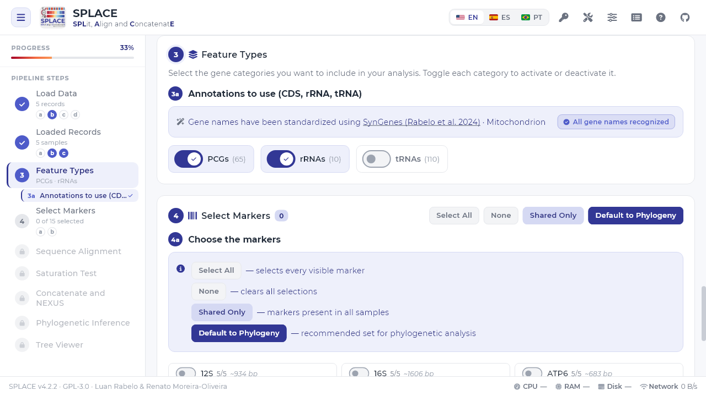

- **3b Choose the markers**: every marker with the number of samples that have it and its mean length. Shortcuts: *Select All*, *None*, *Shared Only* (markers present in every sample) and *Default to Phylogeny* (the recommended set). Missing and duplicated genes are listed, and for duplicates you choose which copy is used.

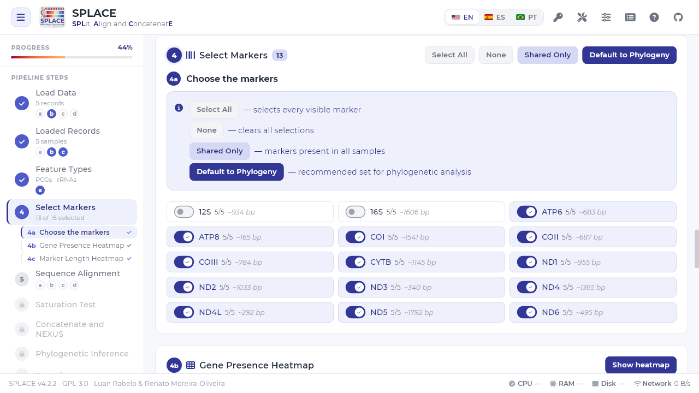

- **3c Gene Presence Heatmap**: markers × samples, showing which genes are present or absent in each sample. Point at a cell for details; click a marker name to select it.

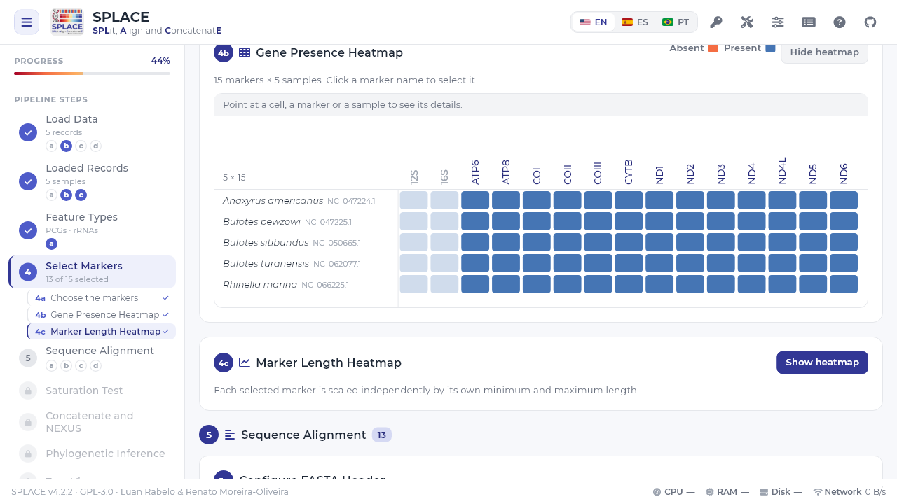

- **3d Marker Length Heatmap**: the length of each marker in each sample, each marker scaled by its own minimum and maximum, to spot truncated or unusually long sequences.


</details>

<details>
<summary>Step 4 - Sequence Alignment</summary>

### Step 4: Sequence Alignment

- **4a Configure FASTA Header**: the **Header Builder** defines the name of each sequence in the alignment files (accession, family, genus, species…), with a live preview. Two sequences of one marker can never share a name: while a name repeats (two records with the same header, a FASTA sample named like a GenBank record, or, with one sample per species, records not identified to species such as *Rhinella* sp.), the alignment and every step after it (trimming, saturation, matrix, trees, delimitation) are locked, and 5a lists the names to fix.
- **4b Sequence Type**: **Nucleotide** (DNA aligned as is), **Amino Acid** (translated with the record's genetic code) or **Codon-aware** (the proteins are aligned with MAFFT and translated back to DNA, so the reading frame is kept). Each option shows an example.


- **4c MAFFT Settings**: alignment method (`--auto` by default), iterations, gap penalties, threads per job and extra flags (`--adjustdirection`, `--reorder`, `--preservecase`), three per row; the **Run MAFFT Alignment** button at the end of 5c aligns every selected marker. Markers are aligned in parallel.


A window shows each marker as it is aligned.

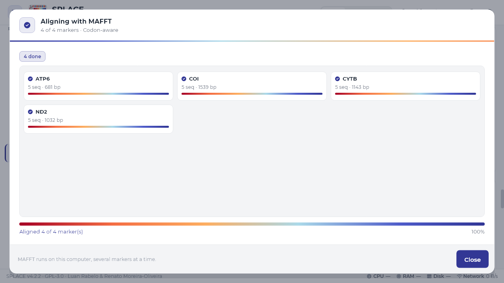

When the alignment finishes, SPLACE asks whether poorly aligned regions should be trimmed, with an animated example of what trimming does.


- **4d Trimming**: trims the alignments with **trimAl** (`-automated1`, `-gappyout`, `-strict`, manual thresholds…) or **ClipKIT**. For protein-coding genes, *Keep the reading frame* removes whole codons (trimAl `-backtrans`, ClipKIT `--codon`), so the 1st, 2nd and 3rd codon positions stay in order for the partitions and the saturation test. The example compares trimming column by column with trimming whole codons.

  **Rules per scenario.** Whole codons are trimmed only where the reading frame is known: coding genes of complete records, codon-aware alignments, and partial fragments (barcodes) whose nucleotide alignment reads in one frame without stop codons. Fragments that do not, non-coding markers and trimAl by columns are trimmed column by column and stay one partition without codon positions; 4d lists how each marker will be trimmed. In codon-aware mode, a fragment partial at the 3' end (`>`) keeps only its whole codons.

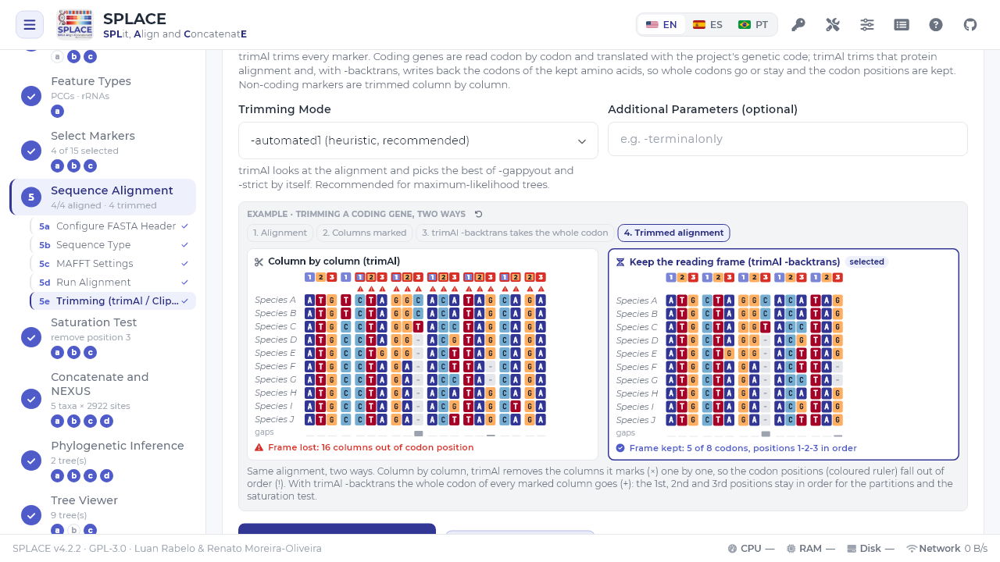

- **Alignment Results**: for each marker, the steps applied (CDS, translation, MAFFT, trimming), the size before and after alignment and trimming, and a colour-coded alignment viewer with the raw, aligned, trimmed and protein versions, conservation bar and DNA, codon or amino-acid view. The **Aligned** tab shows the MAFFT output as it is; the **Trimmed** tab shows the kept columns or, with *Show removed regions*, the whole MAFFT alignment with the columns removed by trimming in grey. *Open folder* shows the files on disk.


</details>

<details>
<summary>Step 5 - Saturation Test</summary>

### Step 5: Saturation Test

Each marker is tested for substitution saturation with **PhyKIT** (Steenwyk et al. 2021; Philippe et al. 2011): IQ-TREE infers the tree of the gene and, for the 1st, 2nd and 3rd codon positions, 1st+2nd and all sites, PhyKIT regresses the uncorrected p-distance of every pair of taxa on their distance in the tree. A value near 1 means no saturation; the closer to 0, the more the observed differences hide repeated substitutions.

- **5a Run the test**: method, programs and versions, and the thresholds used to call a position moderate or saturated (all editable).


- **5b Saturation by locus and codon position**: a heatmap of every marker and codon position, and for each marker the verdict of each position with its plots (p × tree distance, codon positions × tree distance) and a guide to read them.
- **5c What to do with the codon positions**: a recommendation pooled from all markers (for example, remove the 3rd position) that can be applied to the matrix in step 6 with one click.


</details>

<details>
<summary>Step 6 - Concatenate and NEXUS</summary>

### Step 6: Concatenate and NEXUS

- **6a Which alignments to join**: the trimmed alignments (recommended) or the MAFFT output; alignment gaps can be replaced with `?` (missing data).
- **6b How to split the matrix into partitions**: by locus and codon position (recommended), by locus, by codon position (all loci) or one model for the whole matrix. Codon positions can also be removed here (globally or per locus), following the saturation test. Only the schemes that mean something are offered: with one marker, *by codon position* or *none* (by locus would be a single partition); with markers whose codon positions are unknown, *by locus* or *none*.
- **6c Which taxa root the tree**: the outgroup(s).
- **6d Build the matrix**: writes the supermatrix as NEXUS, PHYLIP and FASTA with the partition files for IQ-TREE and RAxML-NG. Samples missing a marker are filled with missing data.

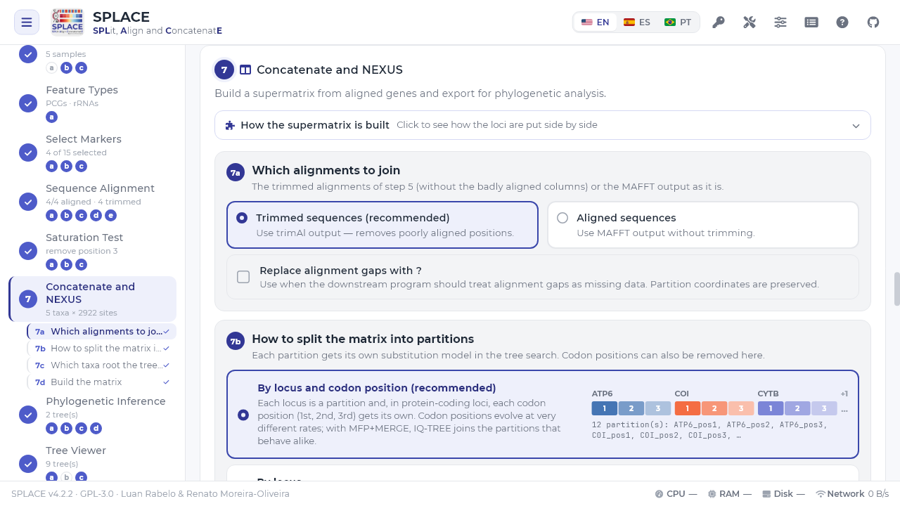

</details>

<details>
<summary>Step 7 - Phylogenetic Inference</summary>

### Step 7: Phylogenetic Inference

- **7a IQ-TREE3**: substitution model (`MFP+MERGE` partition model finder by default, or a fixed model), UFBoot2 bootstrap, SH-aLRT test, threads, tree-search settings (independent runs, stopping rule, perturbation strength, seed), `--bnni` and per-gene trees.


- **7b RAxML-NG**: models chosen by MOOSE (RAxML-NG's own model selection), by IQ-TREE ModelFinder or one fixed model; criterion, tree search, bootstrap trees and support metrics (FBP, TBE, RBS, SH-aLRT, EBG). The exact command is shown before running.

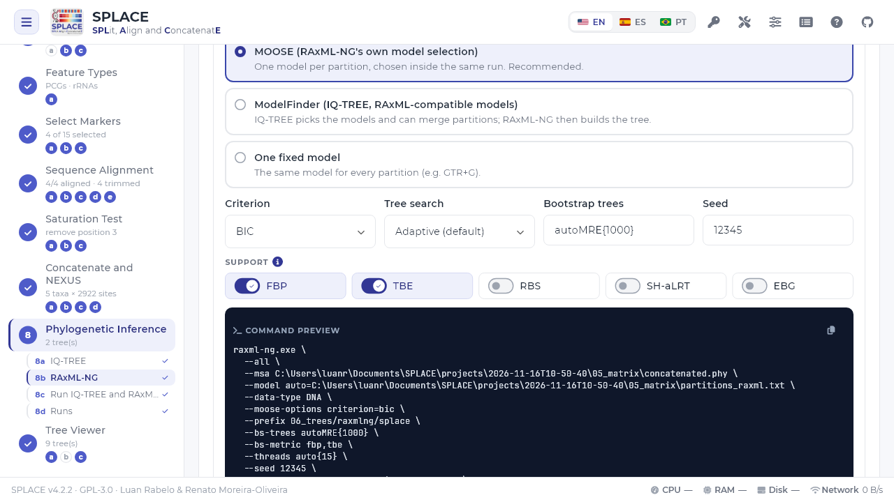

- **7c Run IQ-TREE and RAxML-NG**: runs one program or both at the same time, with a progress window that shows the stage and the last lines of each program.
- **7d Runs**: every run with its date, models, final log-likelihood, the command used, the output folder and files, and the **View tree** button.

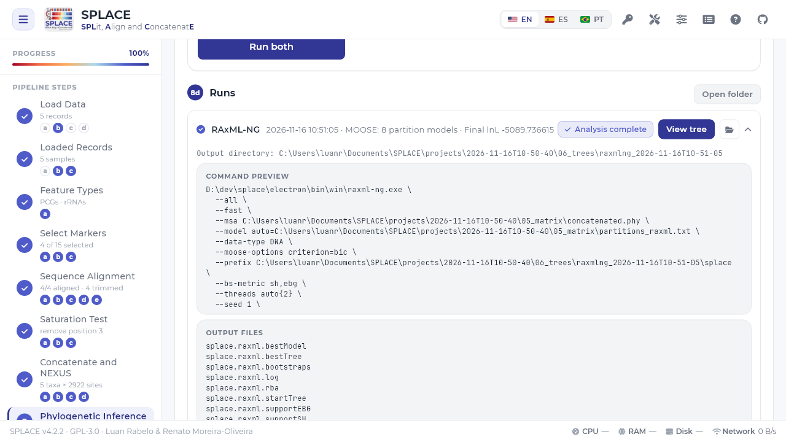

- **7e Species delimitation**: IQ-TREE and RAxML-NG infer the tree but do not delimit species, so SPLACE runs published delimitation programs, in two groups:
  - **On the trees: [mPTP](https://github.com/Pas-Kapli/mptp)** (Kapli et al. 2017) reads the maximum-likelihood tree of each run and finds where the branching changes from speciation (between species) to coalescence (within species), under the **PTP** model (Zhang et al. 2013, `--single`, one coalescent rate for all species) and the **mPTP** model (`--multi`, one rate per species, more robust when species are sampled unevenly). By default the minimum branch length is detected from the p-distances of the supermatrix (`--minbr_auto`, run without `--outgroup_crop`, which mPTP refuses there), and the outgroups of step 7c root the tree and are left out (`--outgroup_crop`). The significance level of the likelihood-ratio test can be set for PTP/mPTP (`--pvalue`, default 0.001) and for GMYC (default 0.01). When the test does not reject the one-species model, the program puts every tip in one species: the result says so, with the p-value, the limit and how many species the best model had found, and the card warns beforehand when every tip is a different species (one sequence per species), the usual reason, since these methods need several individuals per species. Each result shows the number of species, the singletons, the likelihood-ratio test against the one-species model and the commands; the files (`mptp.txt`, `ptp.txt`, the mPTP SVG and a `*.species.tsv` table of tip → species) are in `06_trees/<run>/delimitation/`.
  - **On the alignments: ASAP** (Puillandre, Brouillet & Achaz 2021) and **ABGD** (Puillandre et al. 2012), single-locus methods based on pairwise distances, usually run on a barcode marker (COI, 16S…) but also available for the supermatrix. Choose the alignments, the distance (JC69, the programs' default, K2P, TN93 or p-distance; ABGD offers JC69 and K2P) and ABGD's prior range, steps and gap width (defaults are ABGD's own). ASAP proposes several partitions ranked by its score and ABGD one initial and one recursive partition per prior: a menu on each result chooses the partition that goes to the tree and to the methods text (ASAP: the best score; ABGD: the initial partition at the prior nearest 0.01, to start). The SPART files, the input FASTA and the tip → species table are in `07_delimitation/`.

  - **On the trees: GMYC** (single threshold; Pons et al. 2006) with pGMYC (Zhang et al. 2013, in the Python 3 port by iTaxoTools). GMYC needs an ultrametric tree: the ML tree is first dated with **[LSD2](https://github.com/tothuhien/lsd2)** (To et al. 2016) with relative dates (root at 0, every tip at 1), rooted on the outgroups and without them (or with the root estimated by LSD2). The packages ship GMYC as a standalone program (`tools/gmyc`), so no Python is needed; when running from source, `GUI/tool/package/python_tools.ps1` builds it into `GUI/tools/win` (otherwise Python 3 with `pip install ete3 scipy` is used). Files in `06_trees/<run>/delimitation/gmyc/`.

  **Show on the tree** opens step 8.

</details>

<details>
<summary>Step 8 - Tree Viewer</summary>

### Step 8: Tree Viewer

- **8a Tree and figure**: a preview of the tree at its real printed size, with branch support coloured by value and the outgroup marked. Export it as Newick, SVG or PNG (300 dpi). The figure size is set in centimetres and the fonts in points, so the exported figure does not depend on the monitor.


**Tree editor.** *Open the tree editor* opens the tree in the full window, with a side panel and a canvas that can be moved and zoomed:

- **Tree**: root (outgroup, midpoint or any branch), rectangular or circular layout, phylogram or cladogram, branch style, scales, ladderize, flip and rotate clades.
- **Locality on the labels** (optional): the *Labels* panel offers **Country** and **Locality** among the label parts, and the preset *Species (Locality)*, read from the records' `/geo_loc_name` (or `/country`), which BOLD records carry when BOLD knows where the specimen was collected; tips without a locality show the rest of the label, and hovering a tip shows its locality and coordinates.
- **Branches and support**, **Labels**, **Colours** (colour rows, branches or labels by genus, family…, clade bars with taxon names, highlight and name clades), **Legend** and **Figure and export**.
- Clicking a branch or a tip selects it: re-root, colour, highlight or name the clade, edit the label or remove it from the tree. Every change can be undone.
- **Identify by BLAST** (selection bar or right-click on a tip or clade): useful when a genus falls inside another one. Choose a marker (with how many of the tips have it); each tip's sequence of that marker goes to GenBank BLAST and, for COI (rbcL, matK and ITS in BOLD's plant and fungal databases), to the BOLD ID Engine, with the options of step 2a and its cache. Each tip gets its best match and a verdict (*confirmed*, *another species*, *another genus*, *ambiguous*, *no species at ≥ 98 %*), the alignments of its hits, and the tips named as another species can be renamed in the figure in one undoable step.
- Colouring by a rank gives every taxon its own colour, however many there are (the twelve palette colours first, then new hues).

**Species delimitation on the tree.** Above the figure (and in the *Labels* panel of the editor) there is one button per delimitation, named by tool and tree or alignment (for example *mPTP · IQ-TREE*, *PTP · RAxML-NG*, *ASAP · COI* and *ABGD · COI*). Each button adds a column of bars beside the tip labels, one bar per delimited species (neighbouring species alternate colours), and can be combined with the others to compare tools and trees side by side; the bars are exported with the SVG and PNG. Tips are matched by name, so the delimitation of one tree can also be drawn on the other tree.

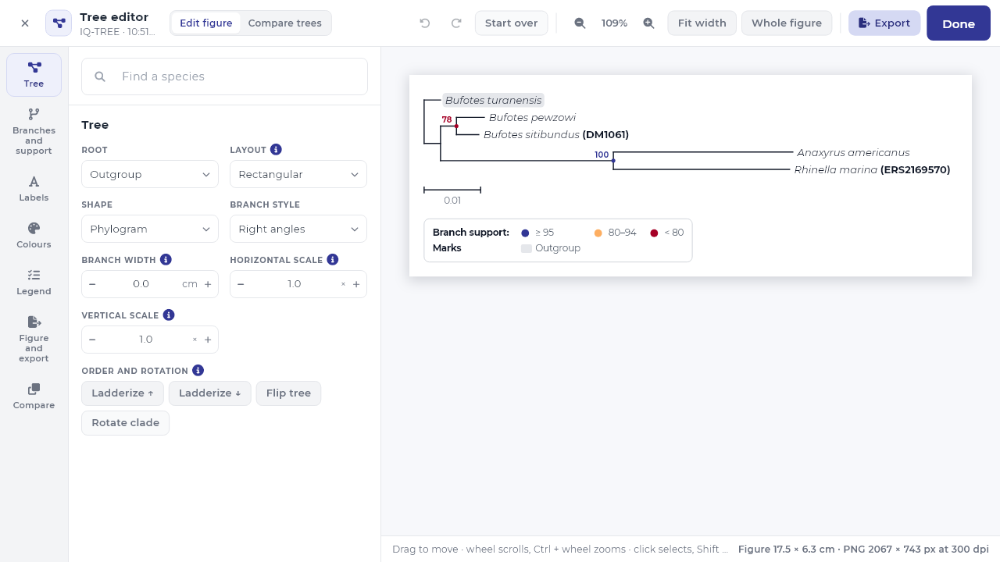


**Compare trees.** Two trees (for example, IQ-TREE and RAxML-NG, or a gene tree and the concatenated tree) face to face, with lines joining each tip to its pair, the clades that differ marked and the Robinson-Foulds distance.


- **8b Save everything**: one ZIP with the sequences, alignments, saturation tables, matrices, partitions, trees and logs of the project.
- **8c How to Cite**: a methods paragraph written from what was actually run (tools, versions, parameters, models, support and species delimitation), the versions used and the references. **SynGenes** and **dataFishing** are highlighted: their names stand out in the text, their GitHub repositories are cited with them, and each has its own card at the top saying what it did in the project (for example, the gene names it standardized or the taxonomy source it queried) with a button to the repository. Every other reference says in one line what the tool did in this project (*What it did: aligned the 13 markers…*). Each part has a *Copy* button.

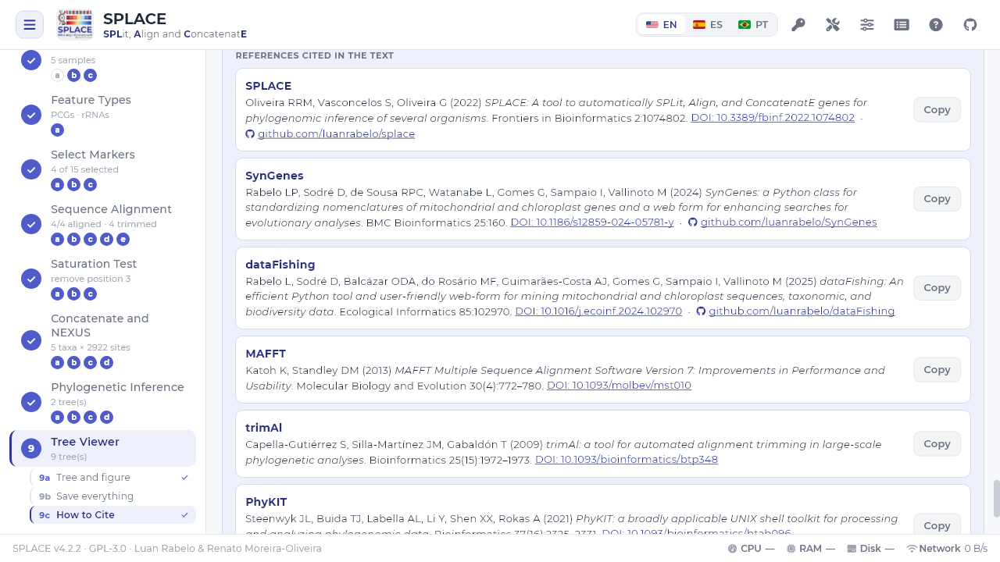

The whole interface is also available in Portuguese and Spanish, with a dark theme:


</details>

### Bundled tools and versions

The packages ship these programs (the wrench button of the top bar shows the version found on your computer, and **How to Cite** reports the versions that actually ran):

| Tool | Version | Used in | Repository |
| :--- | :--- | :--- | :--- |
| [SynGenes](https://github.com/luanrabelo/SynGenes) | built in | gene name standardization, marker queries (steps 1, 3) | [luanrabelo/SynGenes](https://github.com/luanrabelo/SynGenes) |
| [dataFishing](https://github.com/luanrabelo/dataFishing) | built in (method) | taxonomy from GBIF, NCBI Taxonomy or SALVE (step 2) | [luanrabelo/dataFishing](https://github.com/luanrabelo/dataFishing) |
| MAFFT | 7.526 | alignment (step 4) | [mafft.cbrc.jp](https://mafft.cbrc.jp/alignment/software/) |
| trimAl | 1.5.0 | trimming (step 4) | [inab/trimal](https://github.com/inab/trimal) |
| ClipKIT | latest on PyPI when the package is built | trimming (step 4) | [JLSteenwyk/ClipKIT](https://github.com/JLSteenwyk/ClipKIT) |
| PhyKIT | latest on PyPI when the package is built | saturation test (step 5) | [JLSteenwyk/PhyKIT](https://github.com/JLSteenwyk/PhyKIT) |
| IQ-TREE | 3 (`iqtree3`) | gene trees for saturation, ML tree (steps 5, 8) | [iqtree/iqtree3](https://github.com/iqtree/iqtree3) |
| RAxML-NG | 2.0.4 | ML tree (step 7) | [amkozlov/raxml-ng](https://github.com/amkozlov/raxml-ng) |
| mPTP | 0.2.5 (0.2.4 on Intel Macs) | species delimitation on the trees (step 7e) | [Pas-Kapli/mptp](https://github.com/Pas-Kapli/mptp) |
| LSD2 | 2.4.1 | ultrametric tree for GMYC (step 7e) | [tothuhien/lsd2](https://github.com/tothuhien/lsd2) |
| GMYC (pGMYC) | 1.1, Python 3 port by iTaxoTools | species delimitation on the trees (step 7e) | [iTaxoTools/GMYC-pyqt5](https://github.com/iTaxoTools/GMYC-pyqt5) |
| ASAP | command-line sources of 2022 (iTaxoTools) | species delimitation on the alignments (step 7e) | [iTaxoTools/ASAPy](https://github.com/iTaxoTools/ASAPy) |
| ABGD | command-line sources of 2021 (iTaxoTools) | species delimitation on the alignments (step 7e) | [iTaxoTools/ABGDpy](https://github.com/iTaxoTools/ABGDpy) |

RAxML-NG has no official Windows build: `raxml-ng.exe` is compiled from the official 2.0.4 source (see `GUI/tool/raxml-ng-windows`). mPTP comes from its official release binaries (Windows, Linux x86-64, macOS arm64; the last Intel Mac build is 0.2.4). ASAP and ABGD have no binary releases: `GUI/tool/delimitation/build.sh` compiles their C sources (GPL-3.0) for Linux, Windows and macOS (the macOS build runs in the GitHub workflow). All binaries live in `GUI/tools/<platform>`.

&nbsp;

## SPLACE Terminal Mode
##### [:rocket: Go to Contents Overview](#contents-overview)
### Prerequisites
Before you run **SPLACE**, make sure you have the following prerequisites installed on your system:
- **Python Environment and Package Manager**
    - Python **version 3.12 or higher**[^1]
    - conda[^1]
    - git[^1]
- **Required Software and Libraries** (all installed by `environment.yml`)
    - `mafft` 7.526       # Multiple sequence alignment (REQUIRED for --align)
    - `trimal` 1.5.0      # Alignment trimming (REQUIRED for --trimal)
    - `iqtree` 3.0.1      # IQ-TREE 3, run as `iqtree3` (REQUIRED for --iqtree; `iqtree2` is also accepted)
    - `biopython` 1.85    # Sequence handling, GenBank parsing and NCBI Entrez
    - `syngenes` 1.0.6    # Gene nomenclature standardization
    - `requests`          # GBIF HTTP queries
    - `pyyaml`            # YAML configuration files
    - `pandas`, `seaborn`, `matplotlib` # Gene presence report and heatmap

> [!NOTE]
> ClipKIT, PhyKIT, RAxML-NG, mPTP, ASAP and ABGD are used by the **GUI** only. `environment.yml` also installs ClipKIT 2.12.0, so the same environment serves the GUI when it looks for Python tools.

[^1]: These prerequisites are essential for running SPLACE effectively.

&nbsp;
## Installation
##### [:rocket: Go to Contents Overview](#contents-overview)
#### Conda (Recommended)

1. Clone the repository:
```shell
git clone https://github.com/itvgenomics/SPLACE.git
cd SPLACE  
```

2. Create and activate the environment:
```shell
conda env create -f environment.yml
conda activate splace_env
```

#### Pip
If you prefer not to use Conda:
```bash
pip install -e .
```

&nbsp;  
## Usage
#### Parameter Overview
##### [:rocket: Go to Contents Overview](#contents-overview)

The basic syntax is `python splace.py [options]`.

| Parameter | Function | Description |
|-----------|-----------|-------------|
| `-i`, `--input_dir` | Input | Path to a directory containing local **GenBank** or **FASTA** files. Optional when `--ncbi-search-term` is used. |
| `-o`, `--output_dir` | Output | Directory where results will be saved. |
| `--gb-type` | Extraction | Type of Genbank data: `mt` (mitochondrial) or `cp` (chloroplast). Default: `mt`. |
| `--gbif` | Taxonomy | Query GBIF for valid binomial species names (`Genus species`) found in GenBank records and store the recovered ranks in the run metadata table. |
| `--genes` | Filtering | Comma-separated gene names (e.g., `12S,16S,COI`) or path to a text file (one gene per line). Mutually exclusive with `--feature-types`. Default: built-in list per `--gb-type`. |
| `--feature-types` | Filtering | Comma-separated GenBank feature types to extract (e.g., `CDS,rRNA,tRNA`). Mutually exclusive with `--genes`. Default: `CDS`. |
| `--fasta-header-config` | FASTA Header | YAML file that defines the header template for FASTA records. Default: `fasta_header.yaml`. |
| `--ncbi-search-term` | Remote Retrieval | Taxonomic name or rank used by SPLACE to build the NCBI genome query automatically, for example `Bufonidae`, `Coffea`, or `Coffea arabica`. |
| `--apis-env` | Remote Retrieval | Optional path to an `apis.env` file containing `NCBI_API_KEY` and `NCBI_EMAIL`. Default: `apis.env`. |
| `--ncbi-download-dir` | Remote Retrieval | Directory where downloaded GenBank files will be stored. Required with `--ncbi-search-term`. |
| `--ncbi-complete` | Remote Retrieval | Include complete genomes in the automatically generated NCBI query. |
| `--ncbi-partial` | Remote Retrieval | Include partial or incomplete genomes in the automatically generated NCBI query. You may combine it with `--ncbi-complete`. |
| `--ncbi-refseq-only` | Remote Retrieval | Restrict the automatically generated NCBI query to RefSeq genomes only. |
| `--download-only` | Remote Retrieval | Run only the NCBI search/download stage and stop before FASTA extraction or downstream analyses. |
| `--align` | Alignment | Enable multiple sequence alignment using **MAFFT**. |
| `--trimal` | Trimming | Enable trimming using **trimAl**. Requires `--align`. |
| `--iqtree` | Phylogeny | Enable maximum-likelihood inference with **IQ-TREE 3** (`iqtree3 -s supermatrix.nex -T <threads> -B 1000 -m MFP`). Requires `--trimal`. |
| `--allow-missing` | Phylogeny | Allow missing data in the supermatrix (fills with `?`). Without this flag, genes absent from any taxon are removed. |
| `--overwrite` | Output | Overwrite existing output directories if they already exist. Without this flag, SPLACE exits with an error when output directories are present. |
| `--benchmark` | Performance | Enable execution time benchmarking. |
| `-t`, `--threads` | Performance | Number of threads for parallel processing. Default: 8. |
| `--config` | Configuration | Path to a YAML file with custom parameters for MAFFT, trimAl, and IQ-TREE. See [Tool Configuration](#tool-configuration). |

&nbsp;
#### Example Command
##### [:rocket: Go to Contents Overview](#contents-overview)
After installing **SPLACE** and activating the conda environment:

**Full Pipeline (Extract -> Align -> Trim -> Tree)**
```shell
python splace.py -i data/raw/ -o results/ --gb-type mt --gbif --align --trimal --iqtree --threads 8 --benchmark
```

**Extraction and Alignment Only**
```shell
python splace.py -i data/raw/ -o results_aln/ --gb-type mt --align --threads 4
```

**Download GenBank Files from NCBI and Then Process Them**
```shell
python splace.py \
  --ncbi-search-term Bufonidae \
  --ncbi-download-dir data/ncbi_bufonidae \
  --ncbi-complete \
  --apis-env apis.env \
  --ncbi-refseq-only \
  -o results_ncbi \
  --gbif
```

**Search and Download Only**
```shell
python splace.py \
  --ncbi-search-term Bufonidae \
  --ncbi-download-dir data/ncbi_bufonidae \
  --ncbi-complete \
  --ncbi-partial \
  --apis-env apis.env \
  --ncbi-refseq-only \
  --download-only
```

> [!NOTE]
> Choose either `--genes` or `--feature-types` for GenBank extraction filters.

> [!NOTE]
> The script automatically detects input file formats (.gb, .fasta, etc.) across all declared sources.
> `--trimal` requires `--align`, and `--iqtree` requires `--trimal`.

&nbsp;
> [!CAUTION]
> For **Fasta files**, ensure that the sequence headers are formatted correctly to include gene names for proper processing by **SPLACE**.
> Example header format with SynGenes support:
> ```
> > lcl|PX070005.1_cds_XZP64796.1_3 [gene=COX1] ...
> ```
> Or simple formats where the gene name is clear.

&nbsp;
## Tool Configuration
##### [:rocket: Go to Contents Overview](#contents-overview)

You can customize the parameters of **MAFFT**, **trimAl**, and **IQ-TREE 3** by providing a YAML configuration file via the `--config` flag. A default template is included in the repository as `tools_config.yaml`.

```shell
python splace.py -i data/raw/ -o results/ --gb-type mt --align --trimal --iqtree --config tools_config.yaml
```

#### Configuration File Format

```yaml
mafft:
  # Additional MAFFT parameters (e.g., "--auto", "--localpair --maxiterate 1000")
  params: "--auto"
  # Preserve original case of sequences (uppercase/lowercase)
  preserve_case: true
  # Maximum time (in seconds) allowed per alignment
  timeout: 3600

trimal:
  # TrimAl trimming strategy (e.g., "-automated1", "-gappyout", "-strict")
  params: "-automated1"
  # Maximum time (in seconds) allowed per trimming
  timeout: 3600

iqtree:
  # Number of ultrafast bootstrap replicates (-B)
  bootstrap: 1000
  # Substitution model (-m). Use "MFP" for automatic ModelFinder selection
  model: "MFP"
  # Any extra IQ-TREE arguments (e.g., "-alrt 1000" for SH-aLRT test)
  extra_args: ""
```

#### Parameter Reference

| Section | Parameter | Default | Description |
|:---|:---|:---|:---|
| `mafft` | `params` | `--auto` | MAFFT alignment strategy. See [MAFFT documentation](https://mafft.cbrc.jp/alignment/software/manual/manual.html). |
| `mafft` | `preserve_case` | `true` | Keep original sequence case (upper/lowercase). |
| `mafft` | `timeout` | `3600` | Max seconds per alignment job. |
| `trimal` | `params` | `-automated1` | TrimAl trimming method. Alternatives: `-gappyout`, `-strict`, `-gt 0.8`, etc. |
| `trimal` | `timeout` | `3600` | Max seconds per trimming job. |
| `iqtree` | `bootstrap` | `1000` | Ultrafast bootstrap replicates (`-B`). |
| `iqtree` | `model` | `MFP` | Substitution model (`-m`). `MFP` runs ModelFinder automatically. |
| `iqtree` | `extra_args` | *(empty)* | Additional IQ-TREE flags (e.g., `-alrt 1000 -abayes`). |

SPLACE runs the first of `iqtree3`, `iqtree2` or `iqtree` found in `PATH`; the threads come from `--threads` (`-T`).

> [!NOTE]
> If `--config` is not provided, SPLACE uses the default values shown above. You only need to include the sections you want to override — missing sections will use their defaults.

&nbsp;
## Remote Genome Retrieval
##### [:rocket: Go to Contents Overview](#contents-overview)

SPLACE can download nucleotide genomes directly from **NCBI** before scanning and processing the input sources. The Python CLI now performs this stage with **Bio.Entrez** from **Biopython**, which keeps the retrieval logic aligned with the package-oriented future of the project.

SPLACE builds the Entrez query internally from the taxon given to `--ncbi-search-term`, the organelle selected by `--gb-type`, the genome scope flags `--ncbi-complete` and/or `--ncbi-partial`, and the optional `--ncbi-refseq-only` switch.

At least one of `--ncbi-complete` or `--ncbi-partial` must be selected. Both can be used together in the same run.

If an `apis.env` file is available and contains `NCBI_API_KEY`, SPLACE downloads at up to **10 requests per second**. Without that key, SPLACE limits itself to **2 requests per second**.

#### apis.env format

```dotenv
NCBI_API_KEY=your_ncbi_api_key
NCBI_EMAIL=your.email@example.org
```

#### Notes

- The user does not need to write the full Entrez query manually. SPLACE generates it from the provided taxonomic name/rank and genome scope flags.
- `--gb-type mt` builds a mitochondrial query, while `--gb-type cp` builds a chloroplast/plastid query.
- Downloaded records are saved as `.gbk` files in the folder provided to `--ncbi-download-dir`.
- Use `--download-only` when you want to stop after search and retrieval, without running FASTA extraction or any downstream analysis.
- After the retrieval-only stage, this is the recommended moment to add any outgroup files to the input/download folder before running extraction, alignment, trimming, or phylogeny.
- If both `--input_dir` and `--ncbi-search-term` are provided, SPLACE scans both sources in the same run.

#### Two-Step Workflow

1. Run the retrieval stage with `--ncbi-search-term`, `--ncbi-download-dir`, and at least one of `--ncbi-complete` or `--ncbi-partial`.
2. Add any outgroup GenBank or FASTA files that should participate in the analysis.
3. Re-run SPLACE with the usual extraction and analysis flags such as `--gbif`, `--align`, `--trimal`, and `--iqtree`.

Because SPLACE is expected to become a Conda-distributed toolkit that can be embedded in other pipelines, the retrieval logic is intentionally exposed in small reusable functions under the Python package as well.

&nbsp;
## Taxonomy and FASTA Header Metadata
##### [:rocket: Go to Contents Overview](#contents-overview)

When `--gbif` is enabled, SPLACE reads the organism name from each GenBank record and validates whether it follows the binomial pattern `Genus species`. Valid names are queried against the GBIF species API, and the recovered ranks are stored in the metadata output.

Invalid names are not queried. Instead, they are recorded in `logs/invalid_gbif_species.log` together with the source file and accession.

#### FASTA Header Configuration

SPLACE now reads the FASTA header structure from `fasta_header.yaml`. The default file created in the project root is:

```yaml
template: "{accession}_{family}_{genus}_{species}"
missing_value: "?"
```

Supported placeholders are:

| Placeholder | Description |
|:---|:---|
| `accession` | GenBank accession or record identifier |
| `authorship` | GBIF authorship, when available |
| `class` | GBIF class rank |
| `family` | GBIF family rank, or a lineage-derived family fallback when available |
| `file_name` | Source GenBank file name |
| `genus` | Genus parsed from the organism name |
| `kingdom` | GBIF kingdom rank |
| `order` | GBIF order rank |
| `organism` | Full organism name |
| `phylum` | GBIF phylum rank |
| `species` | Specific epithet parsed from the organism name |
| `uid` | Sequential five-digit per-record identifier |

If a placeholder has no value for a given record, SPLACE inserts `?` in the header and records the missing fields in `logs/fasta_header_missing_fields.log`, together with the source file, accession, and marker name.

#### Metadata Outputs

| File | Location | Description |
|:---|:---|:---|
| `genbank_metadata.tsv` | `metadata/` | One row per GenBank record with accession, organism, GBIF status, and retrieved taxonomy ranks. |
| `invalid_gbif_species.log` | `logs/` | Records whose organism names did not match the required `Genus species` pattern for GBIF lookup. |
| `fasta_header_missing_fields.log` | `logs/` | Marker-level log for sequences whose FASTA headers needed `?` placeholders. |

&nbsp;
## Gene Presence Report
##### [:rocket: Go to Contents Overview](#contents-overview)

When phylogenetic analysis is enabled (`--iqtree`), SPLACE automatically generates a **gene presence/absence report** before building the supermatrix. This report helps you identify which taxa are missing which genes — especially useful with `--allow-missing` or when working with chloroplast datasets that contain many genes.

#### Outputs

| File | Location | Description |
|:---|:---|:---|
| `gene_presence_report.txt` | Main output directory | ASCII table printed to console and saved as text. Shows `+` (present) / `-` (absent) per gene per taxon, with totals. |
| `gene_presence_heatmap.png` | Main output directory | Visual heatmap generated with seaborn. Rows are taxa (species in *italic* with accession number and unique ID), columns are genes. Green = present, red = absent. |

#### Example Heatmap

The heatmap provides a quick visual overview of data completeness across your dataset:
- **Rows**: taxa labeled as *Genus species* (Accession) [UID]
- **Columns**: gene names
- **Colors**: green (`Present`) / red (`Absent`)

The figure size adjusts dynamically based on the number of taxa and genes, ensuring readability even for large chloroplast datasets.

> [!TIP]
> Use the heatmap to decide whether `--allow-missing` is appropriate for your dataset. If most cells are green with only a few scattered red cells, allowing missing data is generally safe.

&nbsp;
## Sequence Identifiers
##### [:rocket: Go to Contents Overview](#contents-overview)

Each sequence extracted by SPLACE now receives its FASTA header from the template defined in `fasta_header.yaml`. This makes the Python workflow consistent with the desktop application's configurable header builder.

#### Default Header Format

```
>NC_008535.1_Rubiaceae_Coffea_arabica
```

| Component | Example | Description |
|:---|:---|:---|
| Accession | `NC_008535.1` | GenBank accession or source identifier. |
| Family | `Rubiaceae` | GBIF family rank, or `?` when unavailable. |
| Genus | `Coffea` | Genus parsed from the organism name. |
| Species | `arabica` | Specific epithet parsed from the organism name. |

#### Examples

```
>NC_008535.1_Rubiaceae_Coffea_arabica
>OP946451.1_?_Cinchona_officinalis
>PX000001.1_?_?_?
```

> [!NOTE]
> If you need a guaranteed per-record suffix, include `{uid}` in `fasta_header.yaml`. Missing placeholders are always replaced with `?` and logged for review.

&nbsp;
## SPLACE Workflow
##### [:rocket: Go to Contents Overview](#contents-overview)


## Citing **SPLACE**
##### [:rocket: Go to Contents Overview](#contents-overview)
When referencing **SPLACE**, please cite:
```
Oliveira, R. R. M., Vasconcelos, S., & Oliveira, G. (2022). SPLACE: A tool to automatically SPLit, Align, and ConcatenatE genes for phylogenomic inference of several organisms. Frontiers in Bioinformatics, 2, 1074802.
https://doi.org/10.3389/fbinf.2022.1074802
```

Please also cite the tools SPLACE ran for you. The GUI writes this list for each project in **8c How to Cite**, with the versions and parameters that were actually used and one line per tool saying what it did; the table below summarizes it.

#### Highlighted: gene names and taxonomy

| Tool | What it does in SPLACE | Reference | Code |
| :--- | :--- | :--- | :--- |
| **SynGenes** | Standardizes mitochondrial and chloroplast gene names (COX1, COI, cox1… become one name) in every GenBank and FASTA input, and builds the NCBI queries of individual markers with every synonym of each gene. | Rabelo et al. (2024) *BMC Bioinformatics* 25:160. [doi:10.1186/s12859-024-05781-y](https://doi.org/10.1186/s12859-024-05781-y) | [github.com/luanrabelo/SynGenes](https://github.com/luanrabelo/SynGenes) |
| **dataFishing** | Retrieves the taxonomic classification of the records (GBIF, NCBI Taxonomy or ICMBio SALVE) used in the FASTA headers, the records table and the tree labels and colours. | Rabelo et al. (2025) *Ecological Informatics* 85:102970. [doi:10.1016/j.ecoinf.2024.102970](https://doi.org/10.1016/j.ecoinf.2024.102970) | [github.com/luanrabelo/dataFishing](https://github.com/luanrabelo/dataFishing) |

#### Analysis tools

| Tool | What it does in SPLACE | Reference |
| :--- | :--- | :--- |
| MAFFT | Aligns each marker (nucleotide, amino acid or codon-aware). | Katoh & Standley (2013) *Mol. Biol. Evol.* 30:772–780. [doi:10.1093/molbev/mst010](https://doi.org/10.1093/molbev/mst010) |
| trimAl | Removes poorly aligned regions (whole codons with `-backtrans`). | Capella-Gutiérrez et al. (2009) *Bioinformatics* 25:1972–1973. [doi:10.1093/bioinformatics/btp348](https://doi.org/10.1093/bioinformatics/btp348) |
| ClipKIT (GUI) | Removes poorly aligned regions (whole codons with `--codon`). | Steenwyk et al. (2020) *PLoS Biol.* 18:e3001007. [doi:10.1371/journal.pbio.3001007](https://doi.org/10.1371/journal.pbio.3001007) |
| PhyKIT (GUI) | Substitution saturation test per gene and codon position. | Steenwyk et al. (2021) *Bioinformatics* 37:2325–2331. [doi:10.1093/bioinformatics/btab096](https://doi.org/10.1093/bioinformatics/btab096) |
| IQ-TREE 3 | ML trees, ModelFinder, UFBoot2 and SH-aLRT support. | Wong et al. (2026) *Mol. Biol. Evol.* 43:msag117. [doi:10.1093/molbev/msag117](https://doi.org/10.1093/molbev/msag117) |
| RAxML-NG (GUI) | Second ML tree with bootstrap support (FBP, TBE, RBS, SH-aLRT, EBG). | Kozlov et al. (2019) *Bioinformatics* 35:4453–4455. [doi:10.1093/bioinformatics/btz305](https://doi.org/10.1093/bioinformatics/btz305) |
| mPTP (GUI) | Species delimitation on the ML trees (PTP and mPTP models). | Kapli et al. (2017) *Bioinformatics* 33:1630–1638. [doi:10.1093/bioinformatics/btx025](https://doi.org/10.1093/bioinformatics/btx025); PTP: Zhang et al. (2013) *Bioinformatics* 29:2869–2876. [doi:10.1093/bioinformatics/btt499](https://doi.org/10.1093/bioinformatics/btt499) |
| GMYC (GUI) | Species delimitation on ultrametric trees (single threshold, pGMYC). | Pons et al. (2006) *Syst. Biol.* 55:595–609. [doi:10.1080/10635150600852011](https://doi.org/10.1080/10635150600852011); pGMYC: Zhang et al. (2013), above |
| LSD2 (GUI) | Dates the ML tree (relative dates) for GMYC. | To et al. (2016) *Syst. Biol.* 65:82–97. [doi:10.1093/sysbio/syv068](https://doi.org/10.1093/sysbio/syv068) |
| ASAP (GUI) | Species delimitation from pairwise distances (ranked partitions). | Puillandre, Brouillet & Achaz (2021) *Mol. Ecol. Resour.* 21:609–620. [doi:10.1111/1755-0998.13281](https://doi.org/10.1111/1755-0998.13281) |
| ABGD (GUI) | Barcode gap and species delimitation from pairwise distances. | Puillandre et al. (2012) *Mol. Ecol.* 21:1864–1877. [doi:10.1111/j.1365-294X.2011.05239.x](https://doi.org/10.1111/j.1365-294X.2011.05239.x) |

The methods (ModelFinder, UFBoot2, SH-aLRT, partition merging, TBE, EBG…) are cited in the GUI only when they were used.

***  
## Contact
##### [:rocket: Go to Contents Overview](#contents-overview)
For reporting bugs or feedback, please reach out to **Luan Rabelo**: `luan.rabelo@pq.itv.org`
***  
