<p align="center">
  
</p>

<p align="center">
    <h1 align="center">SPLACE (<b>SP</b>Lit, <b>A</b>lign and <b>C</b>oncatenat<b>E</b>)</h1>
</p>

## Platform Compatibility


<table width="100%">
  <thead>
    <tr>
      <th align="center" width="30%">Operating System</th>
      <th align="center" width="30%">Automated Tests</th>
      <th align="center" width="40%">Downloads</th>
    </tr>
  </thead>
  <tbody>
    <tr>
      <td align="left">
        
      </td>
      <td align="left">
        <a href="https://github.com/luanrabelo/splace/actions/workflows/test-ubuntu.yml"></a>
      </td>
      <td align="left">
        <a href="https://github.com/luanrabelo/splace/releases/latest"></a>
      </td>
    </tr>
    <tr>
      <td align="left">
        
      </td>
      <td align="left">
        <a href="https://github.com/luanrabelo/splace/actions/workflows/test-macos.yml"></a>
      </td>
      <td align="left">
        <a href="https://github.com/luanrabelo/splace/releases/latest"></a>
      </td>
    </tr>
    <tr>
      <td align="left">
        
      </td>
      <td align="left">
        <a href="https://github.com/luanrabelo/splace/actions/workflows/test-windows.yml">
          
        </a>
      </td>
      <td align="left">
        <a href="https://github.com/luanrabelo/splace/releases/latest"></a>
      </td>
    </tr>
  </tbody>
</table>

# Contents Overview
- [System Overview](#system-overview)
- [Licence](#licence)
- [SPLACE GUI](#splace-gui)
  - [Download and installation](#download-and-installation)
  - [Welcome screen and interface](#welcome-screen)
  - [Step 1: Load Data](#step-1-load-data)
  - [Step 2: Loaded Records](#step-2-loaded-records)
  - [Step 3: Feature Types](#step-3-feature-types)
  - [Step 4: Select Markers](#step-4-select-markers)
  - [Step 5: Sequence Alignment](#step-5-sequence-alignment)
  - [Step 6: Saturation Test](#step-6-saturation-test)
  - [Step 7: Concatenate and NEXUS](#step-7-concatenate-and-nexus)
  - [Step 8: Phylogenetic Inference](#step-8-phylogenetic-inference)
  - [Step 9: Tree Viewer](#step-9-tree-viewer)
- [SPLACE Terminal Mode](#splace-terminal-mode)
  - [Prerequisites](#prerequisites)
  - [Installation](#installation)
  - [Usage](#usage)
    - [Parameter Overview](#parameter-overview)
  - [Example Command](#example-command)
  - [Tool Configuration](#tool-configuration)
  - [Remote Genome Retrieval](#remote-genome-retrieval)
  - [Taxonomy and FASTA Header Metadata](#taxonomy-and-fasta-header-metadata)
  - [Gene Presence Report](#gene-presence-report)
  - [Sequence Identifiers](#sequence-identifiers)
- [SPLACE Workflow](#splace-workflow)
- [Citing SPLACE](#citing-splace)
- [Contact](#contact)

***
## ⚠️ Windows Security and Digital Signature

### Running SPLACE on managed or corporate Windows computers

The Windows version of **SPLACE Desktop** is currently distributed without a commercial code-signing certificate.

Because of this, Windows may display a security warning when the application is launched. On personal computers, Windows usually allows the user to manually authorize the application. However, on computers managed by companies, universities, research institutions, or other organizations, security policies may completely prevent unsigned applications from running.

This behavior may be caused by Windows security mechanisms or organizational policies such as **Microsoft Defender SmartScreen**, **AppLocker**, or **Windows Defender Application Control (WDAC)**.

In these environments, SPLACE may:

* Be blocked before execution.
* Display a message indicating that the application is from an unknown publisher.
* Be prevented from running even when the user has administrator privileges.
* Require authorization from the organization's IT department.

> [!IMPORTANT]
> This does not necessarily indicate a problem with the SPLACE installation or executable. It may simply mean that the computer's security policy does not allow applications without a trusted digital signature.

### Recommended alternative: Windows Subsystem for Linux (WSL)

If the Windows executable is blocked by your organization's security policy, we recommend running **SPLACE through Windows Subsystem for Linux (WSL)**.

WSL provides a Linux environment directly within Windows and can be used to run the Linux version of SPLACE without relying on the unsigned Windows executable.

For Windows 11 systems with **WSLg** enabled, graphical Linux applications can also be displayed directly on the Windows desktop.

Before using this alternative, verify that WSL is available and permitted by your organization's IT policies.

### For corporate or institutional environments

If installation of unsigned software is restricted, you may also contact your IT department and request authorization to run SPLACE.

Future Windows releases may be digitally signed to improve compatibility with Windows security policies and managed corporate environments.

***
&nbsp;

## System Overview
##### [:rocket: Go to Contents Overview](#contents-overview)
**SPLACE** is a comprehensive Python toolkit designated to automate phylogenomic analysis pipelines. It handles gene splitting, alignment, trimming, and concatenation, and now supports direct phylogenetic tree inference.

It integrates with **SynGenes** for gene name standardization, **MAFFT** for alignment, **TrimAl** for quality control, and **IQ-TREE** for phylogeny reconstruction, utilizing asynchronous I/O and parallel processing for high performance.

**Key Features:**
*   **Automatic Extraction:** Detects and extracts CDS from GenBank files or genes from FASTA headers suitable for SynGenes.
*   **Gene Normalization:** Ensures consistent gene naming across datasets.
*   **Alignment & Trimming:** Automated MSA and cleaning steps.
*   **Phylogeny:** Supermatrix generation to NEXUS format and ML tree inference with IQ-TREE.
*   **Benchmarking:** Metrics for pipeline performance analysis.

### Version Comparison

| Feature | SPLACE v2/v3 (Legacy) | SPLACE (New) |
| :--- | :--- | :--- |
| **Input Method** | Text file list | Automatic Directory Scan |
| **Execution** | Sequential | Asynchronous & Parallel |
| **Gene Normalization** | basic string split | **SynGenes** Integration |
| **Phylogeny** | Concatenation Only | **IQ-TREE** Integration |
| **Benchmarking** | Manual / Not Built-in | Native (`--benchmark`) |
| **Language/Deps** | Python <3.10 | Python 3.12+ (Asyncio) |

&nbsp;
> [!NOTE]
> This project is an enhanced version of the original SPLACE repository.
> See the original repository at [https://github.com/reinator/splace/](https://github.com/reinator/splace/)

&nbsp;
## Licence
##### [:rocket: Go to Contents Overview](#contents-overview)
**SPLACE** is released under the **GPL-3.0 License**.
&nbsp;

## SPLACE GUI
##### [:rocket: Go to Contents Overview](#contents-overview)

The **SPLACE GUI** is the desktop application of SPLACE (source in [`GUI/`](GUI/)). It runs the whole phylogenomic workflow without the command line: it imports organellar genomes, individual markers or your own FASTA files, standardizes gene names, aligns, trims, tests saturation, builds the supermatrix, infers trees with IQ-TREE3 and RAxML-NG and lets you edit the final figure.

The analysis tools are **bundled** with the application (MAFFT, trimAl, IQ-TREE3, RAxML-NG, ClipKIT and PhyKIT), so nothing else needs to be installed. The interface is available in English, Portuguese and Spanish.

> [!NOTE]
> **SPLACE Web** (the browser version in `docs/`) still offers the import, marker selection and FASTA export steps in the browser. The full workflow (alignment to trees) is in the desktop GUI described below.

### Download and installation

Get the package for your system from the [Releases page](https://github.com/luanrabelo/splace/releases/latest):

| System | File | How to run |
| :--- | :--- | :--- |
| Windows 10/11 (x64) | `SPLACE-<version>-windows-x64.exe` | Portable program, no installation: double-click it. The first start unpacks SPLACE once to `%LOCALAPPDATA%\SPLACE`, later starts are immediate. |
| Linux (Debian, Ubuntu…) | `splace_<version>_amd64.deb` | `sudo apt install ./splace_<version>_amd64.deb`, then open **SPLACE** from the applications menu or run `splace`. |
| Linux (any distribution) | `SPLACE-<version>-x86_64.AppImage` | `chmod +x SPLACE-*.AppImage` and run it. Nothing is installed. |
| macOS 12+ (Apple silicon and Intel) | `SPLACE-<version>-macos-universal.dmg` | Open the disk image and drag **SPLACE** to *Applications*. The first time, right-click the app and choose **Open** (the app is not notarized). |

Results are written to `Documents/SPLACE/projects/<date-time>/` (`01_loci`, `02_aligned`, `03_trimmed`, `04_saturation`, `05_matrix`, `06_trees`). Preferences (language, theme, NCBI API key, tool paths) are kept in `Documents/SPLACE/settings.json`.

<details open>
<summary>Welcome screen and interface overview</summary>

### Welcome screen

The welcome screen summarizes the nine steps of the workflow and the published tools used in each one. Choose the language (EN, ES, PT) in the top-right corner and click **Start App**. The **?** button of the top bar brings this screen back at any time.

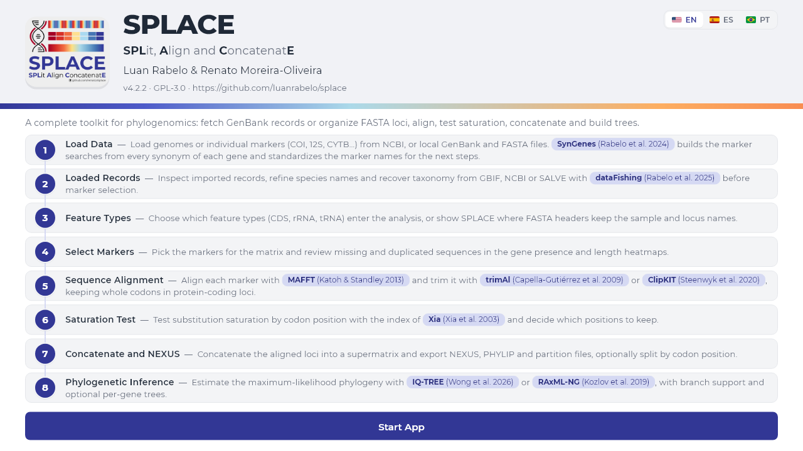

### Interface overview

- **Top bar**: menu button (shows or hides the step navigator), language selector, **NCBI API key** (key icon), **external tools** (wrench), **display settings** (sliders), **activity log**, help and the GitHub repository.
- **Step navigator** (left): the steps of the workflow with the global progress bar. Each step lists its parts (`1a`, `1b`…); completed steps and parts get a check mark, and steps that still need data from previous steps are locked. Clicking a step or part scrolls the page to it.
- **Workspace** (centre): one scrolling page with a card for each step, revealed as the analysis advances.
- **Status bar** (bottom): version, licence and authors, plus live CPU, RAM, disk and network use.

### External tools

The wrench button lists every tool SPLACE found (bundled with the app, in `PATH` or, on Windows, inside WSL), with its version and path. A custom path can be set for each tool.


### Display settings and activity log

The sliders button changes the theme (light, dark or automatic), the density and the text size. The activity log (list button) records every search, download, tool call and error with its time; it can be copied, saved as a text file or cleared.

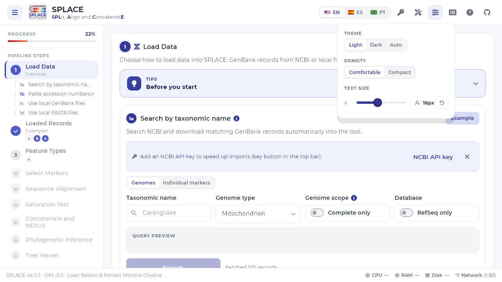

</details>

<details>
<summary>Step 1 - Load Data</summary>

### Step 1: Load Data

Data can come from four sources, and sources can be combined in the same project:

- **1a Search by taxonomic name**: searches NCBI for **genomes** (mitochondrion, chloroplast…) of a taxon, with the options *Complete only* and *RefSeq only*. The query sent to NCBI is shown in *Query preview*.
- **1b Paste accession numbers**: downloads the GenBank records of a list of accessions.
- **1c Use local GenBank files**: opens `.gb`/`.gbk` files or whole folders.
- **1d Use local FASTA files**: opens your own FASTA files (for example, target-capture loci). SPLACE then opens the **Sample and marker** dialog, where you click the parts of the header that name the sample and the marker (or use the file name, `[gene=…]` tags or a regular expression). It recognizes the common layouts (one file per sample with one sequence per locus, one file per locus, or both names in the header), standardizes sample names and writes one FASTA file per marker with identical sample names, ready to align and concatenate.


**Individual markers.** When there are no genomes for a group, switch from *Genomes* to *Individual markers* and choose the markers (12S, 16S, COI, CYTB, ND1…). Each marker is searched with every synonym of the gene in [SynGenes](https://github.com/luanrabelo/SynGenes), and the records are joined by species: one sample per species, with missing markers filled as missing data.


**Review genomes before importing.** Before downloading, SPLACE lists what NCBI found, split into *complete*, *partial* and *UNVERIFIED* records. Filter the list, turn records on or off (or use *Disable UNVERIFIED*, *Only complete*…) and click **Import**.

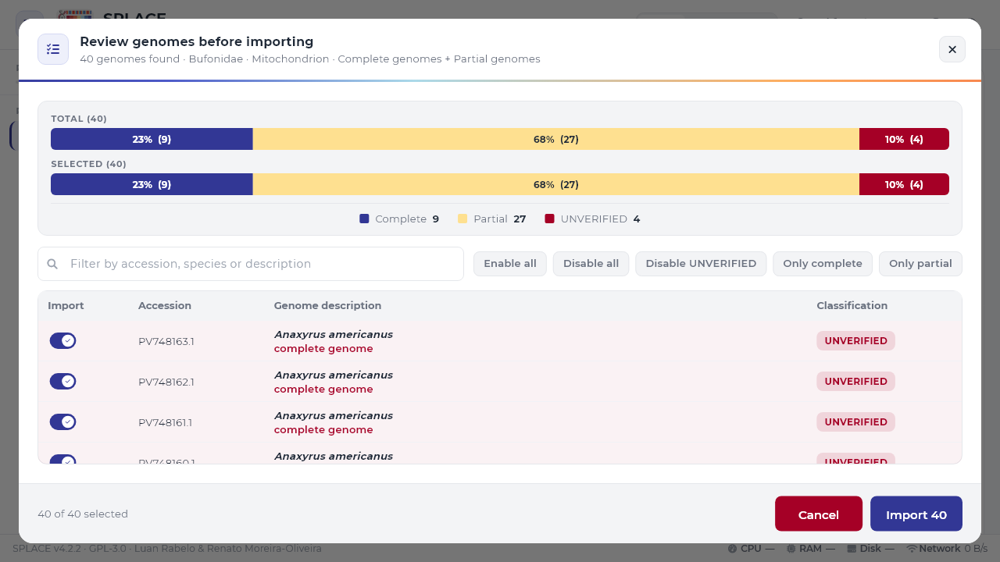

Downloads show their progress in a window that can be cancelled; downloaded records are cached on disk for seven days.

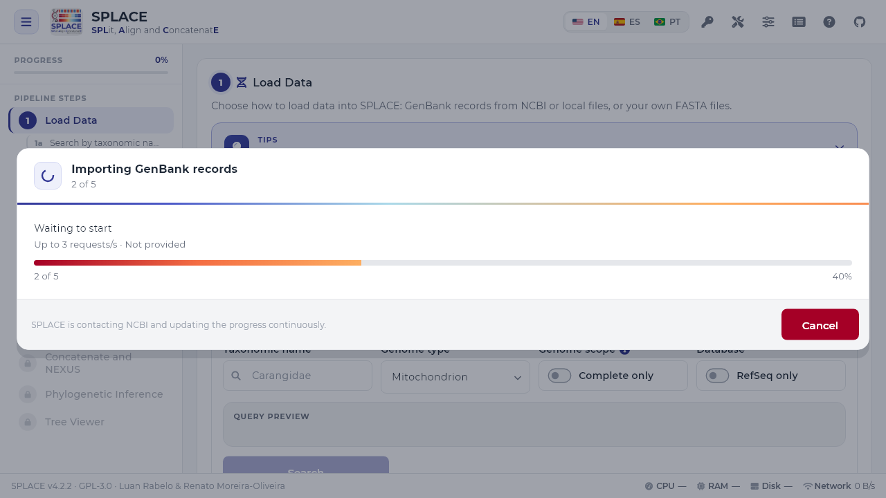

**NCBI API key.** Without a key NCBI allows 3 requests per second; with a free key, 10. The key window estimates the time saved for 50, 200 and 1,000 genomes and explains how to create a key in your NCBI account. The key is stored only on your computer.


</details>

<details>
<summary>Step 2 - Loaded Records</summary>

### Step 2: Loaded Records

- **2a Species identification** (optional): compares a barcode gene (COI, 16S…) of each genome with GenBank (BLAST) and BOLD to find misidentified records, and lets you choose the name to keep for each genome.
- **2b Taxonomy of the records**: fetches the classification with the [dataFishing](https://github.com/luanrabelo/dataFishing) method from **GBIF**, **NCBI Taxonomy** or **ICMBio SALVE** (Brazilian fauna, with the extinction-risk category). *Skip taxonomy and proceed* continues without it.

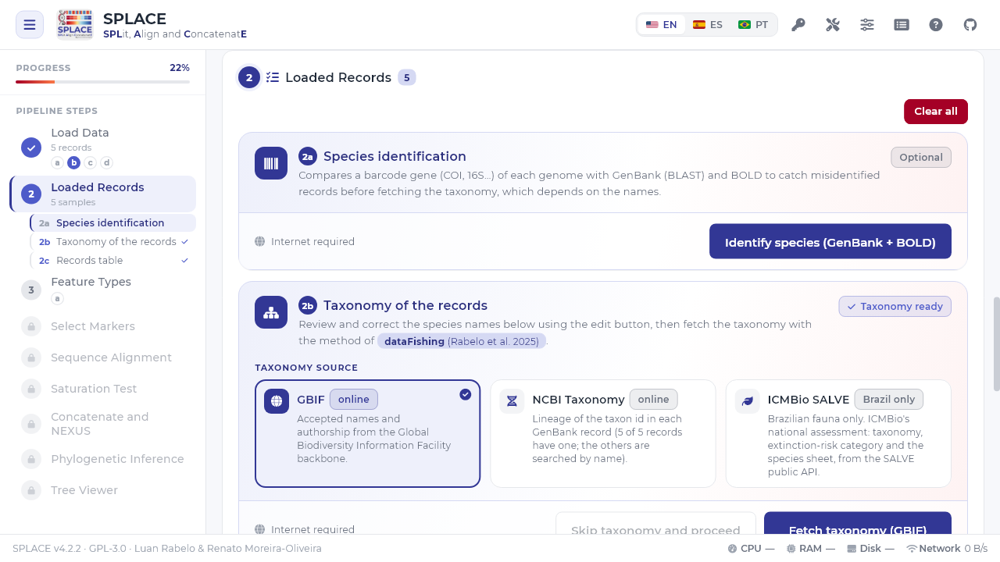

- **2c Records table**: every record with its taxonomy, authorship and the number of protein-coding genes (PCGs), rRNAs and tRNAs. Columns can be shown or hidden, the table can be searched, and each record can be edited or removed. Gene counts that differ from the rest of the dataset are highlighted (possible gene loss or duplication).


</details>

<details>
<summary>Step 3 - Feature Types</summary>

### Step 3: Feature Types

Choose which annotations enter the analysis: **PCGs** (CDS), **rRNAs** and **tRNAs**. Gene names are standardized with SynGenes; names that SynGenes does not recognize are listed so they can be fixed.

With FASTA input this step is called **Sample and Locus Fields** and shows how the sample and locus names were read from the headers.


</details>

<details>
<summary>Step 4 - Select Markers</summary>

### Step 4: Select Markers

- **4a Choose the markers**: every marker with the number of samples that have it and its mean length. Shortcuts: *Select All*, *None*, *Shared Only* (markers present in every sample) and *Default to Phylogeny* (the recommended set). Missing and duplicated genes are listed, and for duplicates you choose which copy is used.


- **4b Gene Presence Heatmap**: markers × samples, showing which genes are present or absent in each sample. Point at a cell for details; click a marker name to select it.


- **4c Marker Length Heatmap**: the length of each marker in each sample, each marker scaled by its own minimum and maximum, to spot truncated or unusually long sequences.

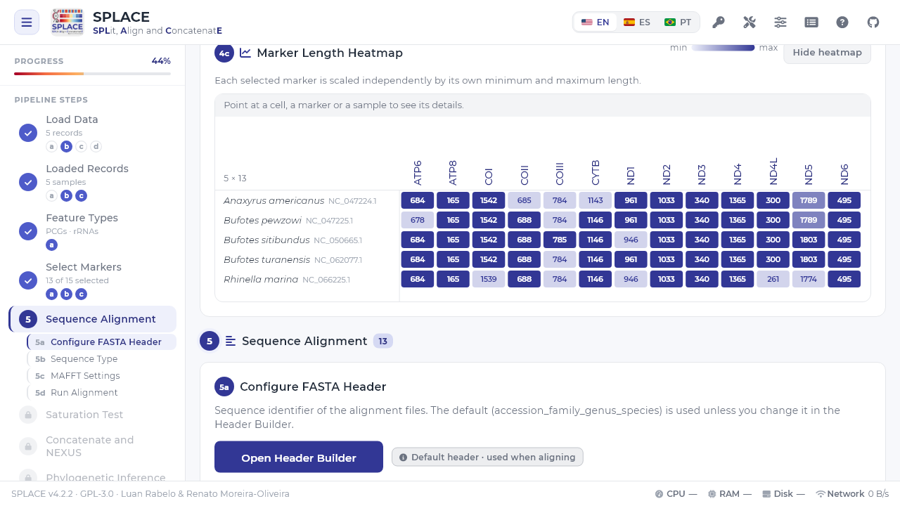

</details>

<details>
<summary>Step 5 - Sequence Alignment</summary>

### Step 5: Sequence Alignment

- **5a Configure FASTA Header**: the **Header Builder** defines the name of each sequence in the alignment files (accession, family, genus, species…), with a live preview.
- **5b Sequence Type**: **Nucleotide** (DNA aligned as is), **Amino Acid** (translated with the record's genetic code) or **Codon-aware** (the proteins are aligned with MAFFT and translated back to DNA, so the reading frame is kept). Each option shows an example.

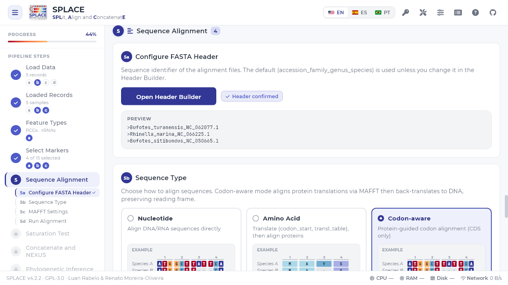

- **5c MAFFT Settings**: alignment method (`--auto` by default), iterations, gap penalties, threads per job and extra flags (`--adjustdirection`, `--reorder`, `--preservecase`). Markers are aligned in parallel.

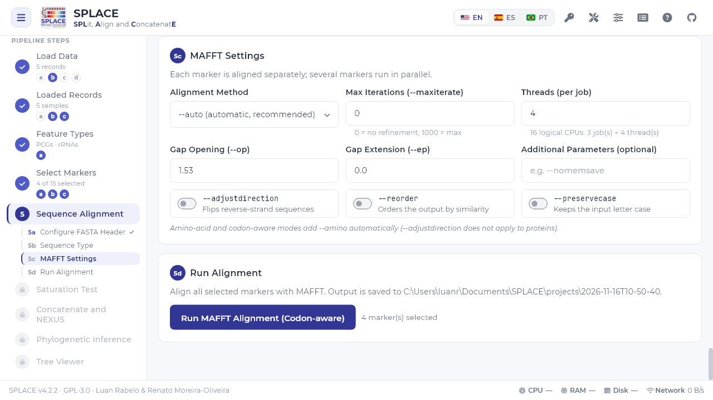

- **5d Run Alignment**: aligns every selected marker with MAFFT. A window shows each marker as it is aligned.


When the alignment finishes, SPLACE asks whether poorly aligned regions should be trimmed, with an animated example of what trimming does.

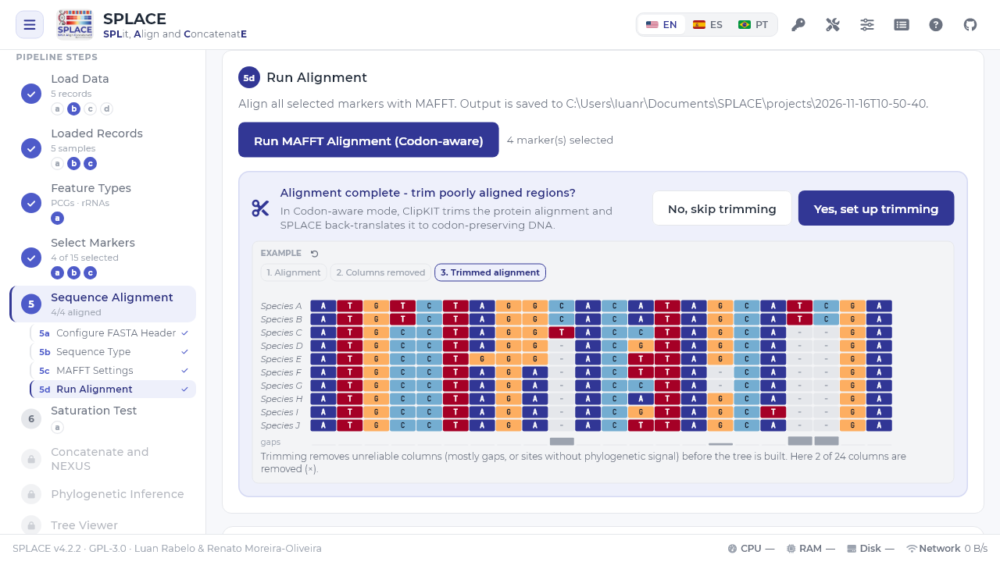

- **5e Trimming**: trims the alignments with **trimAl** (`-automated1`, `-gappyout`, `-strict`, manual thresholds…) or **ClipKIT**. For protein-coding genes, *Keep the reading frame* removes whole codons (trimAl `-backtrans`, ClipKIT `--codon`), so the 1st, 2nd and 3rd codon positions stay in order for the partitions and the saturation test. The example compares trimming column by column with trimming whole codons.


- **Alignment Results**: for each marker, the steps applied (CDS, translation, MAFFT, trimming), the size before and after alignment and trimming, and a colour-coded alignment viewer with the raw, aligned, trimmed and protein versions, conservation bar, DNA, codon or amino-acid view and the trimmed columns marked. *Open folder* shows the files on disk.

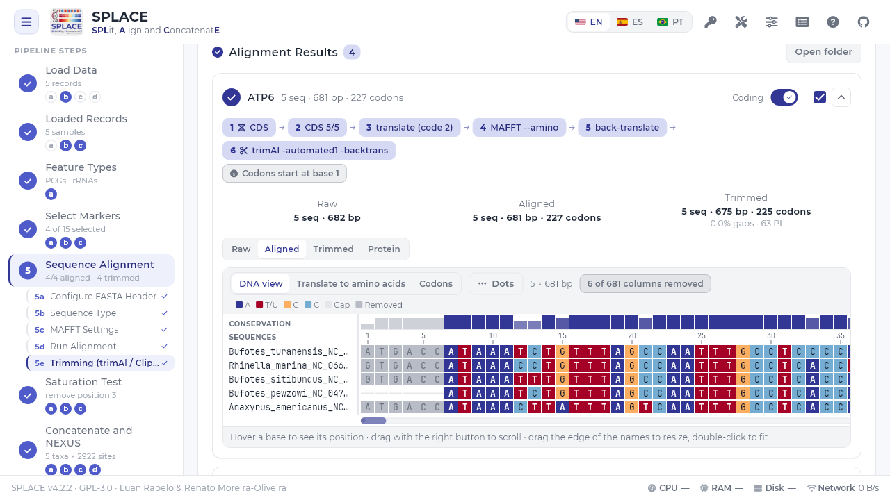

</details>

<details>
<summary>Step 6 - Saturation Test</summary>

### Step 6: Saturation Test

Each marker is tested for substitution saturation with **PhyKIT** (Steenwyk et al. 2021; Philippe et al. 2011): IQ-TREE infers the tree of the gene and, for the 1st, 2nd and 3rd codon positions, 1st+2nd and all sites, PhyKIT regresses the uncorrected p-distance of every pair of taxa on their distance in the tree. A value near 1 means no saturation; the closer to 0, the more the observed differences hide repeated substitutions.

- **6a Run the test**: method, programs and versions, and the thresholds used to call a position moderate or saturated (all editable).

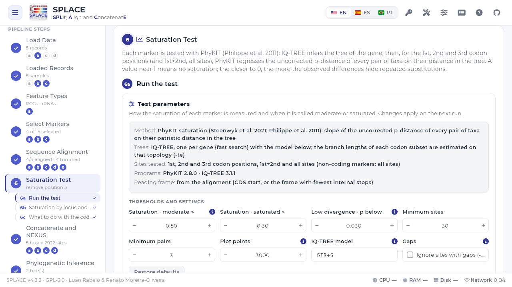

- **6b Saturation by locus and codon position**: a heatmap of every marker and codon position, and for each marker the verdict of each position with its plots (p × tree distance, codon positions × tree distance) and a guide to read them.
- **6c What to do with the codon positions**: a recommendation pooled from all markers (for example, remove the 3rd position) that can be applied to the matrix in step 7 with one click.

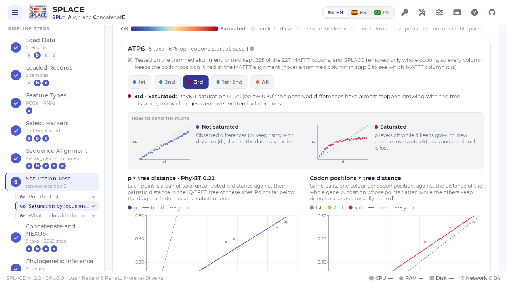

</details>

<details>
<summary>Step 7 - Concatenate and NEXUS</summary>

### Step 7: Concatenate and NEXUS

- **7a Which alignments to join**: the trimmed alignments (recommended) or the MAFFT output; alignment gaps can be replaced with `?` (missing data).
- **7b How to split the matrix into partitions**: by locus and codon position (recommended), by locus, by codon position (all loci) or one model for the whole matrix. Codon positions can also be removed here (globally or per locus), following the saturation test.
- **7c Which taxa root the tree**: the outgroup(s).
- **7d Build the matrix**: writes the supermatrix as NEXUS, PHYLIP and FASTA with the partition files for IQ-TREE and RAxML-NG. Samples missing a marker are filled with missing data.


</details>

<details>
<summary>Step 8 - Phylogenetic Inference</summary>

### Step 8: Phylogenetic Inference

- **8a IQ-TREE3**: substitution model (`MFP+MERGE` partition model finder by default, or a fixed model), UFBoot2 bootstrap, SH-aLRT test, threads, tree-search settings (independent runs, stopping rule, perturbation strength, seed), `--bnni` and per-gene trees.

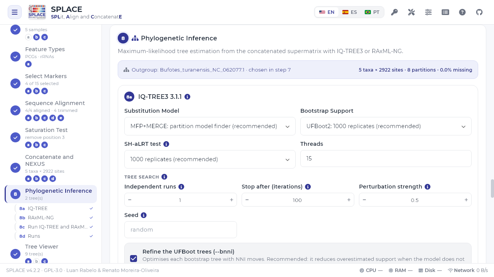

- **8b RAxML-NG**: models chosen by MOOSE (RAxML-NG's own model selection), by IQ-TREE ModelFinder or one fixed model; criterion, tree search, bootstrap trees and support metrics (FBP, TBE, RBS, SH-aLRT, EBG). The exact command is shown before running.


- **8c Run IQ-TREE and RAxML-NG**: runs one program or both at the same time, with a progress window that shows the stage and the last lines of each program.
- **8d Runs**: every run with its date, models, final log-likelihood, the command used, the output folder and files, and the **View tree** button.


</details>

<details>
<summary>Step 9 - Tree Viewer</summary>

### Step 9: Tree Viewer

- **9a Tree and figure**: a preview of the tree at its real printed size, with branch support coloured by value and the outgroup marked. Export it as Newick, SVG or PNG (300 dpi). The figure size is set in centimetres and the fonts in points, so the exported figure does not depend on the monitor.

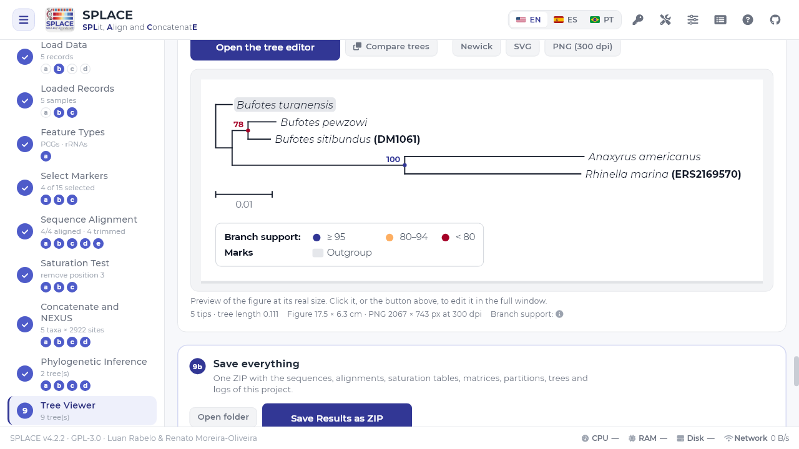

**Tree editor.** *Open the tree editor* opens the tree in the full window, with a side panel and a canvas that can be moved and zoomed:

- **Tree**: root (outgroup, midpoint or any branch), rectangular or circular layout, phylogram or cladogram, branch style, scales, ladderize, flip and rotate clades.
- **Branches and support**, **Labels**, **Colours** (colour rows, branches or labels by genus, family…, clade bars with taxon names, highlight and name clades), **Legend** and **Figure and export**.
- Clicking a branch or a tip selects it: re-root, colour, highlight or name the clade, edit the label or remove it from the tree. Every change can be undone.


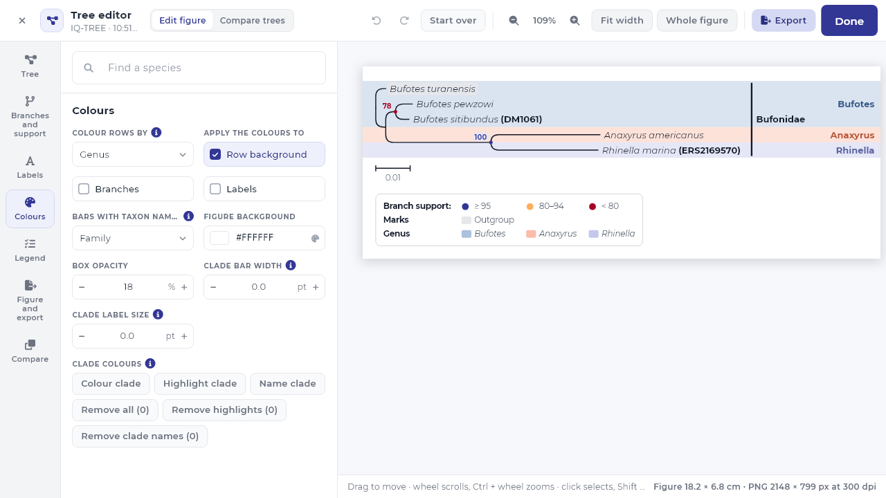

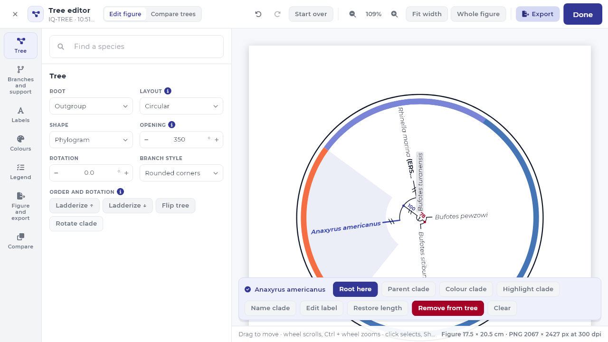

**Compare trees.** Two trees (for example, IQ-TREE and RAxML-NG, or a gene tree and the concatenated tree) face to face, with lines joining each tip to its pair, the clades that differ marked and the Robinson-Foulds distance.

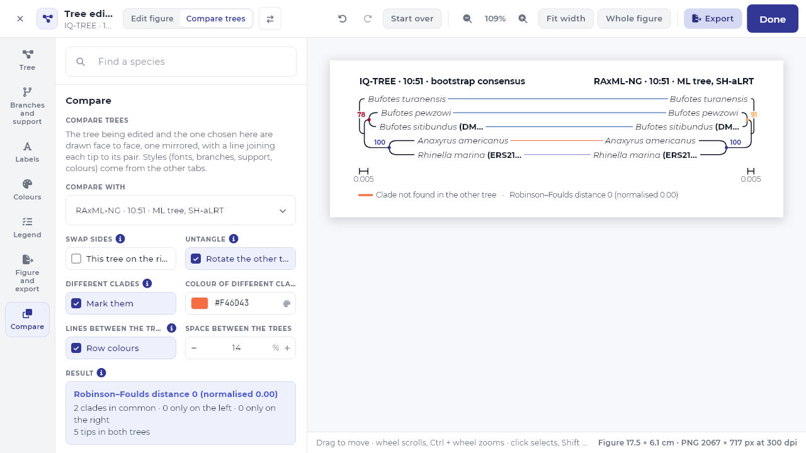

- **9b Save everything**: one ZIP with the sequences, alignments, saturation tables, matrices, partitions, trees and logs of the project.
- **9c How to Cite**: a methods paragraph written from what was actually run (tools, versions, parameters, models and support), the versions used and the references, each with a *Copy* button.


The whole interface is also available in Portuguese and Spanish, with a dark theme:

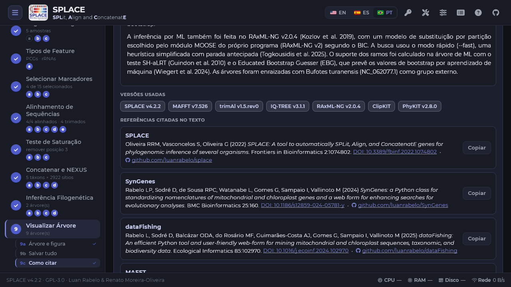

</details>

&nbsp;

## SPLACE Terminal Mode
##### [:rocket: Go to Contents Overview](#contents-overview)
### Prerequisites
Before you run **SPLACE**, make sure you have the following prerequisites installed on your system:
- **Python Environment and Package Manager**
    - Python **version 3.12 or higher**[^1]
    - conda[^1]
    - git[^1]
- **Required Software and Libraries**
    - `mafft`     # For multiple sequence alignment (REQUIRED for --align)
    - `trimal`    # For automated alignment trimming (REQUIRED for --trimal)
    - `iqtree`    # For phylogeny (REQUIRED for --iqtree)
    - `biopython` # For biological sequence handling and parsing
    - `requests`  # For GBIF HTTP queries
    - `syngenes`  # For gene nomenclature standardization
    - `pyyaml`    # For YAML configuration file parsing
    - `seqkit`    # For sequence processing and translation
    - `clipkit`   # Optional for codon-aware trimming (REQUIRED if ClipKIT is selected as the trimming backend)

[^1]: These prerequisites are essential for running SPLACE effectively.

&nbsp;
## Installation
##### [:rocket: Go to Contents Overview](#contents-overview)
#### Conda (Recommended)

1. Clone the repository:
```shell
git clone https://github.com/itvgenomics/SPLACE.git
cd SPLACE  
```

2. Create and activate the environment:
```shell
conda env create -f environment.yml
conda activate splace_env
```

#### Pip
If you prefer not to use Conda:
```bash
pip install -e .
```

&nbsp;  
## Usage
#### Parameter Overview
##### [:rocket: Go to Contents Overview](#contents-overview)

The basic syntax is `python splace.py [options]`.

| Parameter | Function | Description |
|-----------|-----------|-------------|
| `-i`, `--input_dir` | Input | Path to a directory containing local **GenBank** or **FASTA** files. Optional when `--ncbi-search-term` is used. |
| `-o`, `--output_dir` | Output | Directory where results will be saved. |
| `--gb-type` | Extraction | Type of Genbank data: `mt` (mitochondrial) or `cp` (chloroplast). Default: `mt`. |
| `--gbif` | Taxonomy | Query GBIF for valid binomial species names (`Genus species`) found in GenBank records and store the recovered ranks in the run metadata table. |
| `--genes` | Filtering | Comma-separated gene names (e.g., `12S,16S,COI`) or path to a text file (one gene per line). Mutually exclusive with `--feature-types`. Default: built-in list per `--gb-type`. |
| `--feature-types` | Filtering | Comma-separated GenBank feature types to extract (e.g., `CDS,rRNA,tRNA`). Mutually exclusive with `--genes`. Default: `CDS`. |
| `--fasta-header-config` | FASTA Header | YAML file that defines the header template for FASTA records. Default: `fasta_header.yaml`. |
| `--ncbi-search-term` | Remote Retrieval | Taxonomic name or rank used by SPLACE to build the NCBI genome query automatically, for example `Bufonidae`, `Coffea`, or `Coffea arabica`. |
| `--apis-env` | Remote Retrieval | Optional path to an `apis.env` file containing `NCBI_API_KEY` and `NCBI_EMAIL`. Default: `apis.env`. |
| `--ncbi-download-dir` | Remote Retrieval | Directory where downloaded GenBank files will be stored. Required with `--ncbi-search-term`. |
| `--ncbi-complete` | Remote Retrieval | Include complete genomes in the automatically generated NCBI query. |
| `--ncbi-partial` | Remote Retrieval | Include partial or incomplete genomes in the automatically generated NCBI query. You may combine it with `--ncbi-complete`. |
| `--ncbi-refseq-only` | Remote Retrieval | Restrict the automatically generated NCBI query to RefSeq genomes only. |
| `--download-only` | Remote Retrieval | Run only the NCBI search/download stage and stop before FASTA extraction or downstream analyses. |
| `--align` | Alignment | Enable multiple sequence alignment using **MAFFT**. |
| `--trimal` | Trimming | Enable trimming using **TrimAl**. |
| `--iqtree` | Phylogeny | Enable phylogenetic inference using **IQ-TREE**. |
| `--allow-missing` | Phylogeny | Allow missing data in the supermatrix (fills with `?`). Without this flag, genes absent from any taxon are removed. |
| `--overwrite` | Output | Overwrite existing output directories if they already exist. Without this flag, SPLACE exits with an error when output directories are present. |
| `--benchmark` | Performance | Enable execution time benchmarking. |
| `-t`, `--threads` | Performance | Number of threads for parallel processing. Default: 4. |
| `--config` | Configuration | Path to a YAML file with custom parameters for MAFFT, TrimAl, and IQ-TREE. See [Tool Configuration](#tool-configuration). |

&nbsp;
#### Example Command
##### [:rocket: Go to Contents Overview](#contents-overview)
After installing **SPLACE** and activating the conda environment:

**Full Pipeline (Extract -> Align -> Trim -> Tree)**
```shell
python splace.py -i data/raw/ -o results/ --gb-type mt --gbif --align --trimal --iqtree --threads 8 --benchmark
```

**Extraction and Alignment Only**
```shell
python splace.py -i data/raw/ -o results_aln/ --gb-type mt --align --threads 4
```

**Download GenBank Files from NCBI and Then Process Them**
```shell
python splace.py \
  --ncbi-search-term Bufonidae \
  --ncbi-download-dir data/ncbi_bufonidae \
  --ncbi-complete \
  --apis-env apis.env \
  --ncbi-refseq-only \
  -o results_ncbi \
  --gbif
```

**Search and Download Only**
```shell
python splace.py \
  --ncbi-search-term Bufonidae \
  --ncbi-download-dir data/ncbi_bufonidae \
  --ncbi-complete \
  --ncbi-partial \
  --apis-env apis.env \
  --ncbi-refseq-only \
  --download-only
```

> [!NOTE]
> Choose either `--genes` or `--feature-types` for GenBank extraction filters.

> [!NOTE]
> The script automatically detects input file formats (.gb, .fasta, etc.) across all declared sources.
> `--iqtree` requires `--trimal` to be active.

&nbsp;
> [!CAUTION]
> For **Fasta files**, ensure that the sequence headers are formatted correctly to include gene names for proper processing by **SPLACE**.
> Example header format with SynGenes support:
> ```
> > lcl|PX070005.1_cds_XZP64796.1_3 [gene=COX1] ...
> ```
> Or simple formats where the gene name is clear.

&nbsp;
## Tool Configuration
##### [:rocket: Go to Contents Overview](#contents-overview)

You can customize the parameters of **MAFFT**, **TrimAl**, and **IQ-TREE** by providing a YAML configuration file via the `--config` flag. A default template is included in the repository as `tools_config.yaml`.

```shell
python splace.py -i data/raw/ -o results/ --gb-type mt --align --trimal --iqtree --config tools_config.yaml
```

#### Configuration File Format

```yaml
mafft:
  # Additional MAFFT parameters (e.g., "--auto", "--localpair --maxiterate 1000")
  params: "--auto"
  # Preserve original case of sequences (uppercase/lowercase)
  preserve_case: true
  # Maximum time (in seconds) allowed per alignment
  timeout: 3600

trimal:
  # TrimAl trimming strategy (e.g., "-automated1", "-gappyout", "-strict")
  params: "-automated1"
  # Maximum time (in seconds) allowed per trimming
  timeout: 3600

iqtree:
  # Number of ultrafast bootstrap replicates (-B)
  bootstrap: 1000
  # Substitution model (-m). Use "MFP" for automatic ModelFinder selection
  model: "MFP"
  # Any extra IQ-TREE arguments (e.g., "-alrt 1000" for SH-aLRT test)
  extra_args: ""
```

#### Parameter Reference

| Section | Parameter | Default | Description |
|:---|:---|:---|:---|
| `mafft` | `params` | `--auto` | MAFFT alignment strategy. See [MAFFT documentation](https://mafft.cbrc.jp/alignment/software/manual/manual.html). |
| `mafft` | `preserve_case` | `true` | Keep original sequence case (upper/lowercase). |
| `mafft` | `timeout` | `3600` | Max seconds per alignment job. |
| `trimal` | `params` | `-automated1` | TrimAl trimming method. Alternatives: `-gappyout`, `-strict`, `-gt 0.8`, etc. |
| `trimal` | `timeout` | `3600` | Max seconds per trimming job. |
| `iqtree` | `bootstrap` | `1000` | Ultrafast bootstrap replicates (`-B`). |
| `iqtree` | `model` | `MFP` | Substitution model (`-m`). `MFP` runs ModelFinder automatically. |
| `iqtree` | `extra_args` | *(empty)* | Additional IQ-TREE flags (e.g., `-alrt 1000 -abayes`). |

> [!NOTE]
> If `--config` is not provided, SPLACE uses the default values shown above. You only need to include the sections you want to override — missing sections will use their defaults.

&nbsp;
## Remote Genome Retrieval
##### [:rocket: Go to Contents Overview](#contents-overview)

SPLACE can download nucleotide genomes directly from **NCBI** before scanning and processing the input sources. The Python CLI now performs this stage with **Bio.Entrez** from **Biopython**, which keeps the retrieval logic aligned with the package-oriented future of the project.

SPLACE builds the Entrez query internally from the taxon given to `--ncbi-search-term`, the organelle selected by `--gb-type`, the genome scope flags `--ncbi-complete` and/or `--ncbi-partial`, and the optional `--ncbi-refseq-only` switch.

At least one of `--ncbi-complete` or `--ncbi-partial` must be selected. Both can be used together in the same run.

If an `apis.env` file is available and contains `NCBI_API_KEY`, SPLACE downloads at up to **10 requests per second**. Without that key, SPLACE limits itself to **2 requests per second**.

#### apis.env format

```dotenv
NCBI_API_KEY=your_ncbi_api_key
NCBI_EMAIL=your.email@example.org
```

#### Notes

- The user does not need to write the full Entrez query manually. SPLACE generates it from the provided taxonomic name/rank and genome scope flags.
- `--gb-type mt` builds a mitochondrial query, while `--gb-type cp` builds a chloroplast/plastid query.
- Downloaded records are saved as `.gbk` files in the folder provided to `--ncbi-download-dir`.
- Use `--download-only` when you want to stop after search and retrieval, without running FASTA extraction or any downstream analysis.
- After the retrieval-only stage, this is the recommended moment to add any outgroup files to the input/download folder before running extraction, alignment, trimming, or phylogeny.
- If both `--input_dir` and `--ncbi-search-term` are provided, SPLACE scans both sources in the same run.

#### Two-Step Workflow

1. Run the retrieval stage with `--ncbi-search-term`, `--ncbi-download-dir`, and at least one of `--ncbi-complete` or `--ncbi-partial`.
2. Add any outgroup GenBank or FASTA files that should participate in the analysis.
3. Re-run SPLACE with the usual extraction and analysis flags such as `--gbif`, `--align`, `--trimal`, and `--iqtree`.

Because SPLACE is expected to become a Conda-distributed toolkit that can be embedded in other pipelines, the retrieval logic is intentionally exposed in small reusable functions under the Python package as well.

&nbsp;
## Taxonomy and FASTA Header Metadata
##### [:rocket: Go to Contents Overview](#contents-overview)

When `--gbif` is enabled, SPLACE reads the organism name from each GenBank record and validates whether it follows the binomial pattern `Genus species`. Valid names are queried against the GBIF species API, and the recovered ranks are stored in the metadata output.

Invalid names are not queried. Instead, they are recorded in `logs/invalid_gbif_species.log` together with the source file and accession.

#### FASTA Header Configuration

SPLACE now reads the FASTA header structure from `fasta_header.yaml`. The default file created in the project root is:

```yaml
template: "{accession}_{family}_{genus}_{species}"
missing_value: "?"
```

Supported placeholders are:

| Placeholder | Description |
|:---|:---|
| `accession` | GenBank accession or record identifier |
| `authorship` | GBIF authorship, when available |
| `class` | GBIF class rank |
| `family` | GBIF family rank, or a lineage-derived family fallback when available |
| `file_name` | Source GenBank file name |
| `genus` | Genus parsed from the organism name |
| `kingdom` | GBIF kingdom rank |
| `order` | GBIF order rank |
| `organism` | Full organism name |
| `phylum` | GBIF phylum rank |
| `species` | Specific epithet parsed from the organism name |
| `uid` | Sequential five-digit per-record identifier |

If a placeholder has no value for a given record, SPLACE inserts `?` in the header and records the missing fields in `logs/fasta_header_missing_fields.log`, together with the source file, accession, and marker name.

#### Metadata Outputs

| File | Location | Description |
|:---|:---|:---|
| `genbank_metadata.tsv` | `metadata/` | One row per GenBank record with accession, organism, GBIF status, and retrieved taxonomy ranks. |
| `invalid_gbif_species.log` | `logs/` | Records whose organism names did not match the required `Genus species` pattern for GBIF lookup. |
| `fasta_header_missing_fields.log` | `logs/` | Marker-level log for sequences whose FASTA headers needed `?` placeholders. |

&nbsp;
## Gene Presence Report
##### [:rocket: Go to Contents Overview](#contents-overview)

When phylogenetic analysis is enabled (`--iqtree`), SPLACE automatically generates a **gene presence/absence report** before building the supermatrix. This report helps you identify which taxa are missing which genes — especially useful with `--allow-missing` or when working with chloroplast datasets that contain many genes.

#### Outputs

| File | Location | Description |
|:---|:---|:---|
| `gene_presence_report.txt` | Main output directory | ASCII table printed to console and saved as text. Shows `+` (present) / `-` (absent) per gene per taxon, with totals. |
| `gene_presence_heatmap.png` | Main output directory | Visual heatmap generated with seaborn. Rows are taxa (species in *italic* with accession number and unique ID), columns are genes. Green = present, red = absent. |

#### Example Heatmap

The heatmap provides a quick visual overview of data completeness across your dataset:
- **Rows**: taxa labeled as *Genus species* (Accession) [UID]
- **Columns**: gene names
- **Colors**: green (`Present`) / red (`Absent`)

The figure size adjusts dynamically based on the number of taxa and genes, ensuring readability even for large chloroplast datasets.

> [!TIP]
> Use the heatmap to decide whether `--allow-missing` is appropriate for your dataset. If most cells are green with only a few scattered red cells, allowing missing data is generally safe.

&nbsp;
## Sequence Identifiers
##### [:rocket: Go to Contents Overview](#contents-overview)

Each sequence extracted by SPLACE now receives its FASTA header from the template defined in `fasta_header.yaml`. This makes the Python workflow consistent with the desktop application's configurable header builder.

#### Default Header Format

```
>NC_008535.1_Rubiaceae_Coffea_arabica
```

| Component | Example | Description |
|:---|:---|:---|
| Accession | `NC_008535.1` | GenBank accession or source identifier. |
| Family | `Rubiaceae` | GBIF family rank, or `?` when unavailable. |
| Genus | `Coffea` | Genus parsed from the organism name. |
| Species | `arabica` | Specific epithet parsed from the organism name. |

#### Examples

```
>NC_008535.1_Rubiaceae_Coffea_arabica
>OP946451.1_?_Cinchona_officinalis
>PX000001.1_?_?_?
```

> [!NOTE]
> If you need a guaranteed per-record suffix, include `{uid}` in `fasta_header.yaml`. Missing placeholders are always replaced with `?` and logged for review.

&nbsp;
## SPLACE Workflow
##### [:rocket: Go to Contents Overview](#contents-overview)

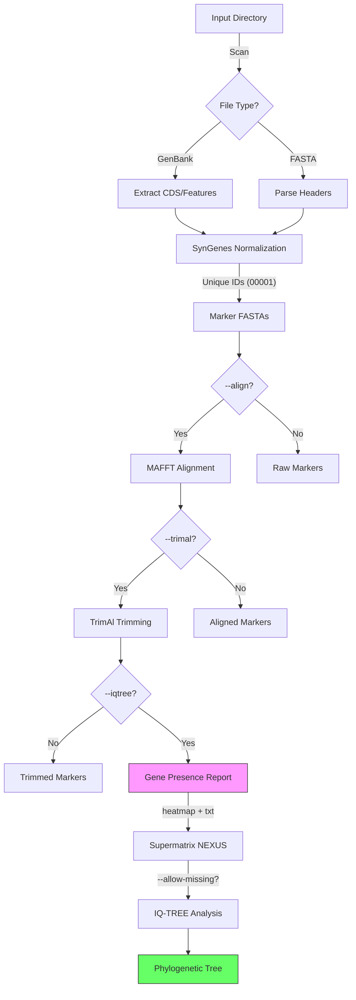

## Citing **SPLACE**
##### [:rocket: Go to Contents Overview](#contents-overview)
When referencing the **SPLACE**, please cite:
```
Oliveira, R. R., Vasconcelos, S., & Oliveira, G. (2022). SPLACE: A tool to automatically SPLit, Align, and ConcatenatE genes for phylogenomic inference of several organisms. Frontiers in Bioinformatics, 2.
https://doi.org/10.3389/fbinf.2022.1074802
```
***  
## Contact
##### [:rocket: Go to Contents Overview](#contents-overview)
For reporting bugs or feedback, please reach out to **Luan Rabelo**: `luan.rabelo@pq.itv.org`
***  
